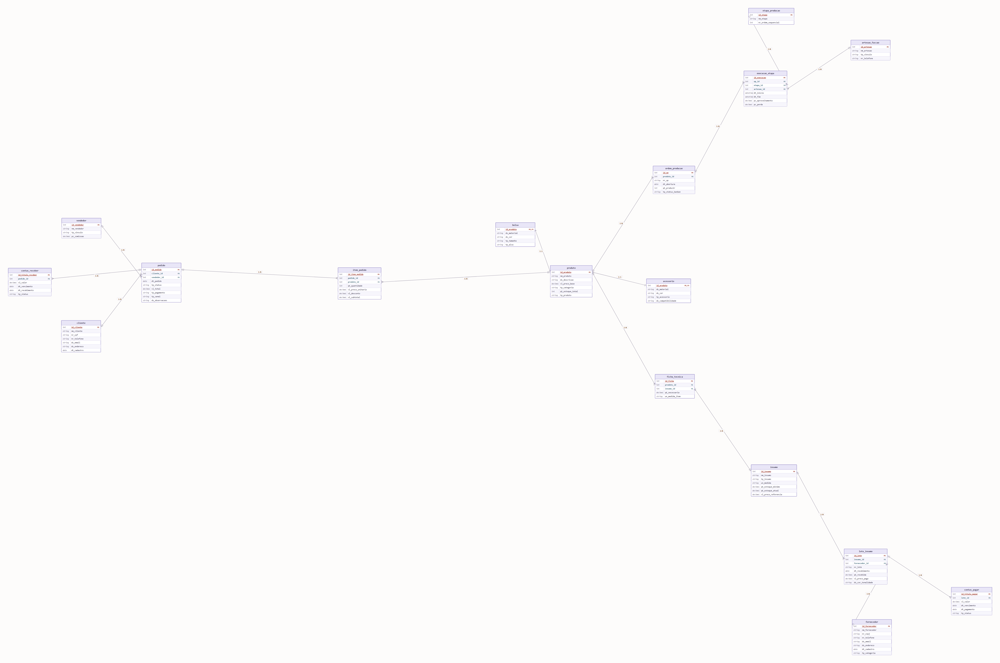

# Modelo Lógico Relacional — Contrasti Bolsas e Acessórios

> Documento separado exigido pela Seção 2 do esqueleto da Entrega 2. Implementado integralmente em `script.sql` (Seção 2 do script = `CREATE TABLE` de todas as tabelas abaixo). Para a justificativa de cada decisão de conversão, ver `RELATORIO_TECNICO.md`, Seções 1.2 a 1.5.

> **v2 (15/10/2026)** — reescrito para o modelo de 17 entidades corrigido na Entrega 1, em resposta à avaliação do professor ([issue #1](https://github.com/matheusmontagner8/Modelagem-de-Dados/issues/1)). Colunas renomeadas para o padrão de prefixos do dicionário (`id_`/`nm_`/`ds_`/`dt_`/`vl_`/`qt_`/`pc_`/`tp_`/`nr_`/`un_`). 17 tabelas, uma por entidade do DER — nenhuma tabela associativa extra foi necessária além das já previstas no conceitual (`lote_insumo`, `ficha_tecnica`, `execucao_etapa`, `item_pedido`).

## Diagrama do modelo lógico

Notação de tabela (estilo crow's foot): cada caixa é uma tabela física, com tipo | coluna | `PK`/`FK` por linha; a "pata de galinha" (▷<) marca o lado "muitos" de cada FK e o traço simples (⊢) marca o lado "um" da PK referenciada, e cada linha traz também o rótulo do tipo de ligação (`1:N` ou `1:1`). `bolsa` e `acessorio` usam traço simples nas duas pontas e rótulo `1:1`, porque a relação com `produto` é de chave compartilhada (especialização) — todas as demais 14 ligações são `1:N`. **Este diagrama é do modelo lógico/físico (Entrega 2)** — diferente do DER conceitual da Entrega 1 (`../Diagrama/Diagrama.png`), que segue notação de Chen e, por exigência da disciplina, não mostra FK nem tipo físico dentro das entidades. Gerado a partir desta mesma especificação de tabelas (script determinístico, sem edição manual).

---

## fornecedor

| Coluna | Tipo | Restrições |
|---|---|---|
| **id_fornecedor** | `INT UNSIGNED` | **PK**, `AUTO_INCREMENT` |
| nm_fornecedor | `VARCHAR(150)` | `NOT NULL` |
| nr_cnpj | `VARCHAR(18)` | `NOT NULL`, `UNIQUE` |
| nr_telefone | `VARCHAR(20)` | |
| ds_email | `VARCHAR(160)` | |
| ds_endereco | `VARCHAR(200)` | |
| dt_cadastro | `DATE` | `NOT NULL`, padrão data atual |
| tp_categoria | `VARCHAR(30)` | `NOT NULL`, `CHECK IN ('Couro','Ferragem','Ziper','Embalagem')` |

## insumo

| Coluna | Tipo | Restrições |
|---|---|---|
| **id_insumo** | `INT UNSIGNED` | **PK**, `AUTO_INCREMENT` |
| nm_insumo | `VARCHAR(120)` | `NOT NULL` |
| tp_insumo | `VARCHAR(30)` | `NOT NULL` |
| un_medida | `VARCHAR(10)` | `NOT NULL`, `CHECK IN ('DM2','M2','UN','M','KG','L')` |
| qt_estoque_minimo | `DECIMAL(10,3)` | `NOT NULL`, padrão `0`, `CHECK >= 0` |
| qt_estoque_atual | `DECIMAL(10,3)` | `NOT NULL`, padrão `0`, `CHECK >= 0` |
| vl_preco_referencia | `DECIMAL(10,2)` | `NOT NULL`, `CHECK > 0` |

**Sem FK para fornecedor** — diferente da v1, que tinha `fornecedor_id NOT NULL` direto aqui. A origem de cada recebimento agora é responsabilidade de `lote_insumo` (abaixo), porque um mesmo insumo pode vir de fornecedores diferentes ao longo do tempo (ver Critério 10 da avaliação do professor).

## lote_insumo *(nova, associativa)*

| Coluna | Tipo | Restrições |
|---|---|---|
| **id_lote** | `INT UNSIGNED` | **PK**, `AUTO_INCREMENT` |
| *insumo_id* | `INT UNSIGNED` | **FK** → `insumo.id_insumo`, `NOT NULL` |
| *fornecedor_id* | `INT UNSIGNED` | **FK** → `fornecedor.id_fornecedor`, `NOT NULL` |
| nr_lote | `VARCHAR(30)` | `NOT NULL` |
| dt_recebimento | `DATE` | `NOT NULL` |
| qt_recebida | `DECIMAL(10,3)` | `NOT NULL`, `CHECK > 0` |
| vl_preco_pago | `DECIMAL(10,2)` | `NOT NULL`, `CHECK > 0` |
| ds_cor_tonalidade | `VARCHAR(60)` | opcional |

## produto *(supertipo)*

| Coluna | Tipo | Restrições |
|---|---|---|
| **id_produto** | `INT UNSIGNED` | **PK**, `AUTO_INCREMENT` |
| nm_produto | `VARCHAR(120)` | `NOT NULL` |
| ds_descricao | `VARCHAR(255)` | |
| vl_preco_base | `DECIMAL(10,2)` | `NOT NULL`, `CHECK > 0` |
| tp_categoria | `VARCHAR(50)` | |
| qt_estoque_total | `INT UNSIGNED` | `NOT NULL`, padrão `0` |
| tp_produto | `VARCHAR(10)` | `NOT NULL`, `CHECK IN ('BOLSA','ACESSORIO')` — discriminador da especialização |

## bolsa *(subtipo de produto)*

| Coluna | Tipo | Restrições |
|---|---|---|
| **id_produto** | `INT UNSIGNED` | **PK** e **FK** → `produto.id_produto`, `ON DELETE CASCADE` |
| ds_material | `VARCHAR(60)` | `NOT NULL` |
| ds_cor | `VARCHAR(40)` | `NOT NULL` |
| tp_tamanho | `VARCHAR(20)` | `NOT NULL` |
| tp_alca | `VARCHAR(30)` | `NOT NULL` |

## acessorio *(subtipo de produto)*

| Coluna | Tipo | Restrições |
|---|---|---|
| **id_produto** | `INT UNSIGNED` | **PK** e **FK** → `produto.id_produto`, `ON DELETE CASCADE` |
| ds_material | `VARCHAR(60)` | `NOT NULL` |
| ds_cor | `VARCHAR(40)` | `NOT NULL` |
| tp_acessorio | `VARCHAR(30)` | `NOT NULL` |
| ds_compatibilidade | `VARCHAR(120)` | opcional |

## ficha_tecnica *(associativa, agora com chave própria)*

| Coluna | Tipo | Restrições |
|---|---|---|
| **id_ficha** | `INT UNSIGNED` | **PK**, `AUTO_INCREMENT` |
| *produto_id* | `INT UNSIGNED` | **FK** → `produto.id_produto`, `NOT NULL`, `ON DELETE CASCADE` |
| *insumo_id* | `INT UNSIGNED` | **FK** → `insumo.id_insumo`, `NOT NULL` |
| qt_necessaria | `DECIMAL(10,3)` | `NOT NULL`, `CHECK > 0` |
| un_medida_item | `VARCHAR(10)` | `NOT NULL` |

`UNIQUE (produto_id, insumo_id)` substitui a antiga PK composta por FKs — mesma regra de negócio garantida ("cada par produto/insumo aparece uma única vez"), sem usar FK como identificador (apontado como agravante pelo professor no Critério 10).

## ordem_producao *(nova, essencial)*

| Coluna | Tipo | Restrições |
|---|---|---|
| **id_op** | `INT UNSIGNED` | **PK**, `AUTO_INCREMENT` |
| *produto_id* | `INT UNSIGNED` | **FK** → `produto.id_produto`, `NOT NULL` |
| nr_op | `VARCHAR(20)` | `NOT NULL`, `UNIQUE` |
| dt_abertura | `DATE` | `NOT NULL` |
| qt_produzir | `INT UNSIGNED` | `NOT NULL`, `CHECK > 0` |
| tp_status_kanban | `VARCHAR(20)` | `NOT NULL`, `CHECK IN ('aberta','em producao','concluida','cancelada')` |

## etapa_producao *(nova, tabela de domínio)*

| Coluna | Tipo | Restrições |
|---|---|---|
| **id_etapa** | `INT UNSIGNED` | **PK**, `AUTO_INCREMENT` |
| nm_etapa | `VARCHAR(60)` | `NOT NULL` |
| nr_ordem_sequencial | `SMALLINT UNSIGNED` | `NOT NULL`, `UNIQUE` |

## artesao_faccao *(nova)*

| Coluna | Tipo | Restrições |
|---|---|---|
| **id_artesao** | `INT UNSIGNED` | **PK**, `AUTO_INCREMENT` |
| nm_artesao | `VARCHAR(120)` | `NOT NULL` |
| tp_vinculo | `VARCHAR(20)` | `NOT NULL`, `CHECK IN ('interno','faccao terceirizada')` |
| nr_telefone | `VARCHAR(20)` | |

## execucao_etapa *(nova, associativa de três vias)*

| Coluna | Tipo | Restrições |
|---|---|---|
| **id_execucao** | `INT UNSIGNED` | **PK**, `AUTO_INCREMENT` |
| *op_id* | `INT UNSIGNED` | **FK** → `ordem_producao.id_op`, `NOT NULL`, `ON DELETE CASCADE` |
| *etapa_id* | `INT UNSIGNED` | **FK** → `etapa_producao.id_etapa`, `NOT NULL` |
| *artesao_id* | `INT UNSIGNED` | **FK** → `artesao_faccao.id_artesao`, `NOT NULL` |
| dt_inicio | `DATETIME` | `NOT NULL` |
| dt_fim | `DATETIME` | opcional (nulo enquanto em andamento) |
| pc_aproveitamento | `DECIMAL(5,2)` | `CHECK BETWEEN 0 AND 100`, preenchido só na etapa de Corte |
| pc_perda | `DECIMAL(5,2)` | `CHECK BETWEEN 0 AND 100`, preenchido só na etapa de Corte |

## cliente

| Coluna | Tipo | Restrições |
|---|---|---|
| **id_cliente** | `INT UNSIGNED` | **PK**, `AUTO_INCREMENT` |
| nm_cliente | `VARCHAR(150)` | `NOT NULL` |
| nr_cpf | `VARCHAR(14)` | `NOT NULL`, `UNIQUE` |
| nr_telefone | `VARCHAR(20)` | |
| ds_email | `VARCHAR(160)` | |
| ds_endereco | `VARCHAR(200)` | |
| dt_cadastro | `DATE` | `NOT NULL`, padrão data atual |

## vendedor *(nova)*

| Coluna | Tipo | Restrições |
|---|---|---|
| **id_vendedor** | `INT UNSIGNED` | **PK**, `AUTO_INCREMENT` |
| nm_vendedor | `VARCHAR(120)` | `NOT NULL` |
| tp_vinculo | `VARCHAR(25)` | `NOT NULL`, `CHECK IN ('interno','representante externo')` |
| pc_comissao | `DECIMAL(5,2)` | `NOT NULL` |

## pedido

| Coluna | Tipo | Restrições |
|---|---|---|
| **id_pedido** | `INT UNSIGNED` | **PK**, `AUTO_INCREMENT` |
| *cliente_id* | `INT UNSIGNED` | **FK** → `cliente.id_cliente`, `NOT NULL` |
| *vendedor_id* | `INT UNSIGNED` | **FK** → `vendedor.id_vendedor`, `NOT NULL` |
| dt_pedido | `DATE` | `NOT NULL`, padrão data atual |
| tp_status | `VARCHAR(20)` | `NOT NULL`, padrão `'Aberto'`, `CHECK IN ('Aberto','Faturado','Expedido','Cancelado')` |
| vl_total | `DECIMAL(10,2)` | `NOT NULL`, padrão `0` — denormalização controlada (ver `RELATORIO_TECNICO.md` §1.4) |
| tp_pagamento | `VARCHAR(10)` | `CHECK IN ('PIX','Cartao','Boleto')` |
| tp_canal | `VARCHAR(20)` | `NOT NULL`, `CHECK IN ('loja fisica','e-commerce','atacado')` |
| ds_observacoes | `VARCHAR(255)` | opcional |

## item_pedido *(associativa, identificador próprio)*

| Coluna | Tipo | Restrições |
|---|---|---|
| **id_item_pedido** | `INT UNSIGNED` | **PK**, `AUTO_INCREMENT` |
| *pedido_id* | `INT UNSIGNED` | **FK** → `pedido.id_pedido`, `NOT NULL`, `ON DELETE CASCADE` |
| *produto_id* | `INT UNSIGNED` | **FK** → `produto.id_produto`, `NOT NULL` |
| qt_quantidade | `INT UNSIGNED` | `NOT NULL`, `CHECK > 0` |
| vl_preco_unitario | `DECIMAL(10,2)` | `NOT NULL`, `CHECK > 0` |
| vl_desconto | `DECIMAL(10,2)` | `NOT NULL`, padrão `0`, `CHECK >= 0` |
| vl_subtotal | `DECIMAL(10,2)` | `GENERATED ALWAYS AS (qt_quantidade * vl_preco_unitario - vl_desconto) STORED` |

## contas_receber *(nova)*

| Coluna | Tipo | Restrições |
|---|---|---|
| **id_titulo_receber** | `INT UNSIGNED` | **PK**, `AUTO_INCREMENT` |
| *pedido_id* | `INT UNSIGNED` | **FK** → `pedido.id_pedido`, `NOT NULL` |
| vl_valor | `DECIMAL(10,2)` | `NOT NULL`, `CHECK > 0` |
| dt_vencimento | `DATE` | `NOT NULL` |
| dt_recebimento | `DATE` | opcional |
| tp_status | `VARCHAR(15)` | `NOT NULL`, `CHECK IN ('em aberto','pago','atrasado','cancelado')` |

## contas_pagar *(nova)*

| Coluna | Tipo | Restrições |
|---|---|---|
| **id_titulo_pagar** | `INT UNSIGNED` | **PK**, `AUTO_INCREMENT` |
| *lote_id* | `INT UNSIGNED` | **FK** → `lote_insumo.id_lote`, `NOT NULL` |
| vl_valor | `DECIMAL(10,2)` | `NOT NULL`, `CHECK > 0` |
| dt_vencimento | `DATE` | `NOT NULL` |
| dt_pagamento | `DATE` | opcional |
| tp_status | `VARCHAR(15)` | `NOT NULL`, `CHECK IN ('em aberto','pago','atrasado','cancelado')` |

---

## Cardinalidades já convertidas

| FK | Tabela "N" | Tabela "1" | Obrigatoriedade |
|---|---|---|---|
| `lote_insumo.insumo_id` | lote_insumo | insumo | `NOT NULL` |
| `lote_insumo.fornecedor_id` | lote_insumo | fornecedor | `NOT NULL` |
| `ficha_tecnica.produto_id` | ficha_tecnica | produto | `NOT NULL` |
| `ficha_tecnica.insumo_id` | ficha_tecnica | insumo | `NOT NULL` |
| `bolsa.id_produto` | bolsa | produto | `NOT NULL`, relação 1:1 (PK compartilhada) |
| `acessorio.id_produto` | acessorio | produto | `NOT NULL`, relação 1:1 (PK compartilhada) |
| `ordem_producao.produto_id` | ordem_producao | produto | `NOT NULL` |
| `execucao_etapa.op_id` | execucao_etapa | ordem_producao | `NOT NULL` |
| `execucao_etapa.etapa_id` | execucao_etapa | etapa_producao | `NOT NULL` |
| `execucao_etapa.artesao_id` | execucao_etapa | artesao_faccao | `NOT NULL` |
| `pedido.cliente_id` | pedido | cliente | `NOT NULL` |
| `pedido.vendedor_id` | pedido | vendedor | `NOT NULL` |
| `item_pedido.produto_id` | item_pedido | produto | `NOT NULL` |
| `item_pedido.pedido_id` | item_pedido | pedido | `NOT NULL` |
| `contas_receber.pedido_id` | contas_receber | pedido | `NOT NULL` |
| `contas_pagar.lote_id` | contas_pagar | lote_insumo | `NOT NULL` |

Nenhuma cardinalidade N:N restou no modelo lógico — todas já tinham sido resolvidas por entidades associativas desde o DER conceitual (ver `RELATORIO_TECNICO.md` §1.2).

## Restrições de integridade (resumo)

- **Chave**: toda PK listada acima; `ficha_tecnica.UNIQUE(produto_id, insumo_id)` impede duplicar o par produto/insumo sem usar FK como identificador.
- **Unicidade**: `fornecedor.nr_cnpj`, `cliente.nr_cpf`, `ordem_producao.nr_op`, `etapa_producao.nr_ordem_sequencial`.
- **Domínio (`CHECK`)**: `tp_categoria`, `un_medida`, `tp_produto`, `tp_status`, `tp_pagamento`, `tp_canal`, `tp_status_kanban`, `tp_vinculo` (em artesão e vendedor), além de todos os `CHECK > 0` / `CHECK >= 0` em preços, estoques e quantidades.
- **Referencial (`FOREIGN KEY`)**: todas as FKs da tabela de cardinalidades acima; `ON DELETE CASCADE` em `bolsa`, `acessorio`, `ficha_tecnica`, `item_pedido` e `execucao_etapa` (ver justificativa em `RELATORIO_TECNICO.md` §1.5).
