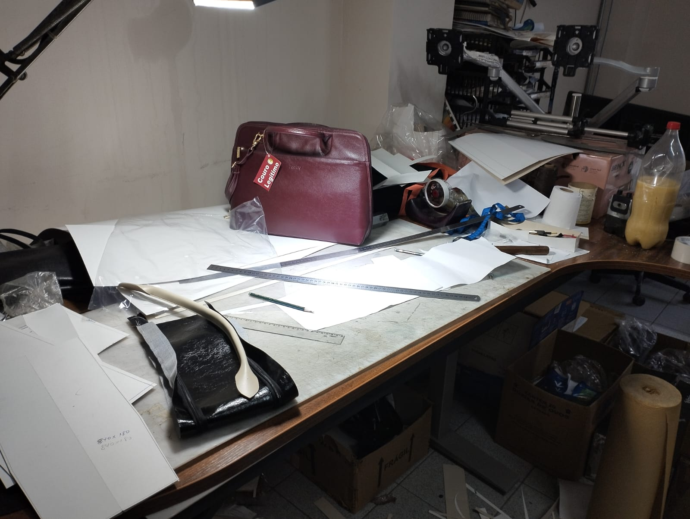
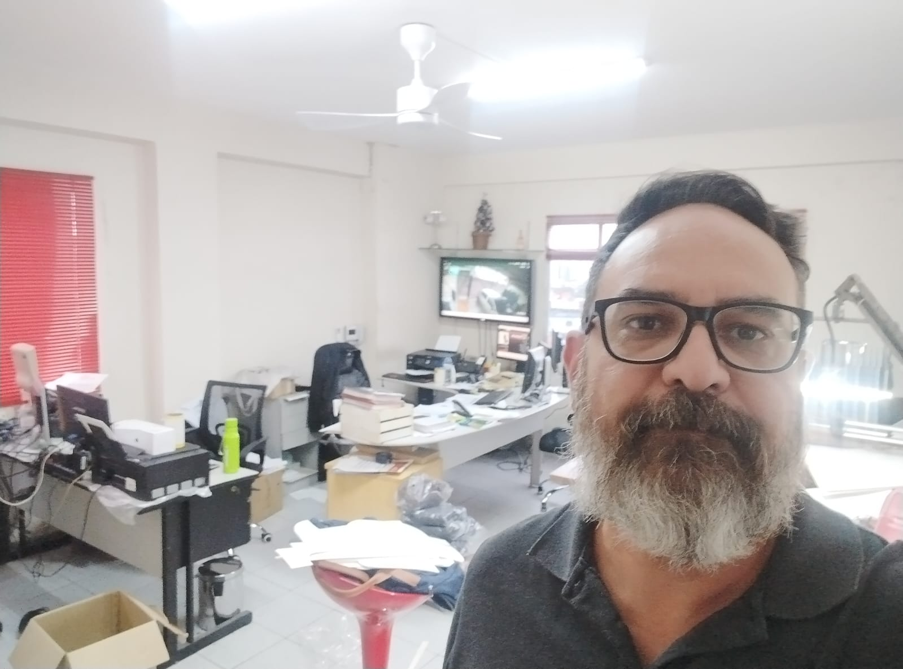
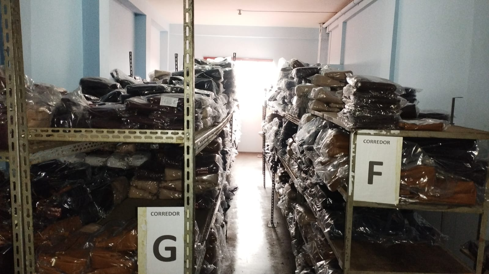
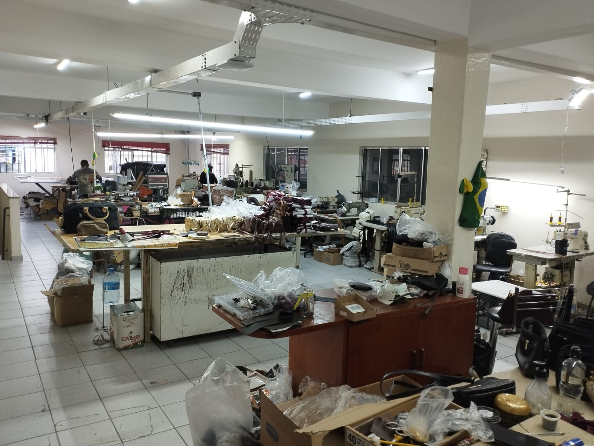
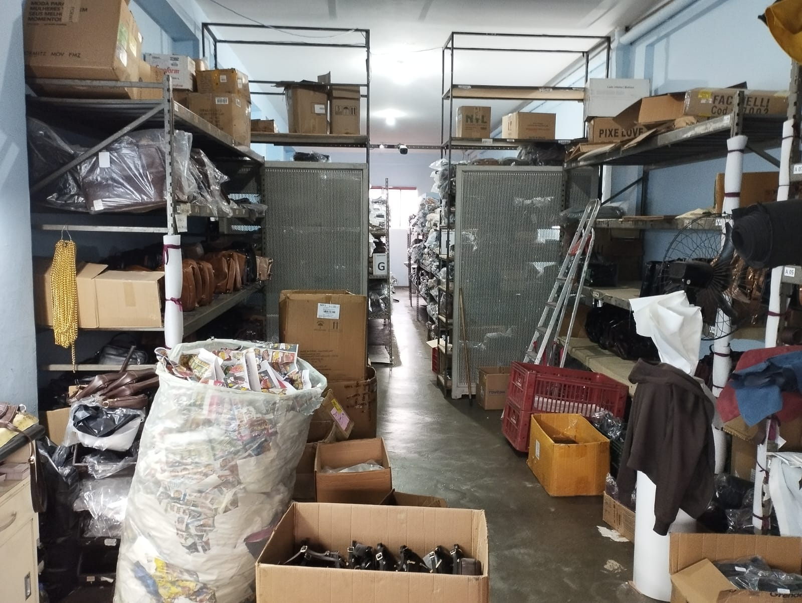
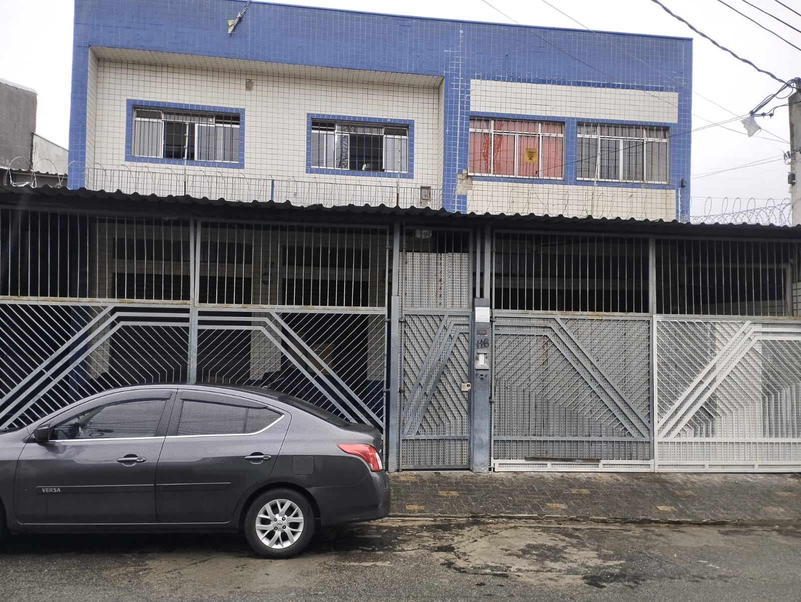

## Metadados

| Nome | RGM |
|---|---|
| Guilherme da Silva Ferreira Batista | 47302518 |
| Guilherme Petrucelli Domingos | 47270161 |
| Jaime Luiz de Oliveira Neto | 47336951 |
| Matheus Montagner | 47209470 |
| Vinicius Marques de Melo | 47213426 |

---

## 1. Caracterização da Organização

- **Nome e natureza da organização:** Contrasti Bolsas e Acessórios Ltda — Indústria e Comércio de Bolsas e Acessórios de Couro, com fins lucrativos. Produção própria, com venda direta e por canais diversos (loja física, e-commerce, WhatsApp, representantes externos).
- **O que foi observado diretamente na visita:** oficina de costura com múltiplas máquinas, bancada de corte/produção, estoque segmentado entre insumos e produtos prontos, e uso de facções terceirizadas para parte da produção (evidências fotográficas abaixo). Volume de pedidos informado pelo responsável: 50 a 70 por mês, com aumento nas datas comemorativas (Dia das Mães e Natal).
- 🔴 **Pendente de confirmação com a organização:** número exato de pessoas na equipe, e o relato formal de uma crise ou dificuldade operacional específica. O grupo percebeu indícios de processos manuais durante a visita (estoque sem rastreabilidade de lote por fornecedor, ausência de regra formal de crédito, cálculo de custo não padronizado) — mas isso é leitura do grupo sobre o que viu, não uma declaração do responsável, e por isso não está registrado aqui como fato confirmado. Fica como item a verificar em um próximo contato com Osmar Lingiard.
- **Como o levantamento foi feito:** visita presencial às instalações (fotos tiradas dentro da fábrica e do escritório administrativo, evidências abaixo) e entrevista com o responsável pela empresa, Osmar Lingiard, complementada por um questionário estruturado preenchido durante a conversa.
- **Justificativa da escolha:** organização de acesso facilitado para o grupo, com processos observáveis em uma única visita — nem tão simples a ponto de não ter o que modelar, nem tão complexa a ponto de inviabilizar o levantamento no prazo da disciplina.
- **Evidências da organização:** Endereço: Rua Alpiste, 116 - Jd. Eliane - São Paulo - SP. Contato na empresa: Osmar Lingiard, telefone para contato: 11 97334-4846, email: osmar@specia.com.br.

  
  
  

  
  
  

*Da esquerda para a direita, de cima para baixo: bancada de produção (corte/costura), escritório administrativo (espaço de trabalho do responsável pela empresa), estoque de bolsas prontas (corredor G), oficina com as máquinas de costura, estoque de insumos/materiais, fachada na Rua Alpiste.*

## 2. Processos de Negócio

**Visão geral do fluxo entre processos:** Compras (2/4) abastece a Produção (3/5), que abastece Vendas (6), que aciona Expedição (7); Compras e Vendas, por sua vez, geram lançamentos no Financeiro (8). Cadastro de clientes (1) é pré-requisito de Vendas (6).

1. **Cadastro e gestão de clientes** — Cadastro (dados, perfil varejo/atacado, múltiplos endereços) → Consulta de restrição de CPF/CNPJ → Aprovação de crédito quando o pagamento é a prazo (boleto) → cliente liberado para pedido. *Integra com:* Vendas (processo 6), que só abre pedido para cliente cadastrado e aprovado.
2. **Cadastro e gestão de fornecedores** — Cadastro (dados, categoria de insumo, prazo médio de entrega) → registro de cada compra recebida → atualização do histórico de avaliação (preço, variação, pontualidade). *Integra com:* Estoque/Compras (processo 4), que usa o fornecedor cadastrado para registrar cada lote recebido, e Financeiro (processo 8), que gera o título a pagar.
3. **Ficha técnica e cadastro de produtos** — Cadastro do modelo → definição das variações (SKU: cor × tipo de couro × ferragem) → montagem da lista de materiais (BOM/ficha técnica) → cálculo automático de custo e preço sugerido (ficha técnica + mão de obra + markup). *Integra com:* Estoque (consome o saldo de insumo listado na ficha técnica) e Vendas (fornece o preço base do produto).
4. **Gestão de estoque e compras** — Entrada de insumo por lote (XML de NF-e ou manual, com fornecedor e cor/tonalidade do lote) → atualização do saldo na unidade de medida correta → monitoramento de estoque mínimo com alerta → baixa automática na abertura de Ordem de Produção. *Integra com:* Fornecedores (processo 2, origem do lote), Produção (processo 5, consumo do insumo) e Financeiro (processo 8, título a pagar por lote).
5. **Ordem de produção e chão de fábrica** — Abertura de OP vinculada a um SKU → baixa automática do insumo necessário → execução por etapa (Modelagem → Corte → Preparação/Colagem → Costura → Montagem/Ferragens → Acabamento/Revisão → Embalagem), com Kanban e controle de aproveitamento de couro por etapa de corte → produto pronto disponível em estoque. *Integra com:* Ficha técnica (processo 3, o que consumir), Estoque (processo 4, baixa de insumo e alta de produto pronto) e remuneração de artesão pela etapa executada.
6. **Vendas, pedidos e faturamento** — Abertura do pedido por canal (loja física, e-commerce, WhatsApp, representante) → definição de forma de pagamento e congelamento do preço no item → faturamento e emissão de NF-e/NFC-e → cálculo de comissão do vendedor sobre o pedido faturado. *Integra com:* Cadastro de clientes (processo 1, pré-requisito), Estoque (processo 4, baixa de produto pronto), Expedição (processo 7, próximo passo) e Financeiro (processo 8, título a receber).
7. **Expedição e pós-venda** — Separação e conferência por código de barras (picking) → embalagem (checklist + dust bag) → envio com integração logística e rastreio → registro de troca/devolução/garantia (RMA) vinculado ao item efetivamente entregue. *Integra com:* Vendas (processo 6, pedido de origem) e Financeiro (processo 8, estorno em caso de devolução).
8. **Gestão financeira e relatórios gerenciais** — Geração automática de Contas a Pagar (a partir de cada lote de insumo recebido, processo 2/4) e Contas a Receber (a partir de cada pedido faturado, processo 6) → baixa conforme pagamento/recebimento → consolidação em indicadores gerenciais (Curva ABC, margem por produto, DRE, fluxo de caixa previsto × realizado). *Integra com:* todos os processos anteriores — é o ponto de encontro dos dois fluxos de caixa (compras e vendas).

---

## 3. Requisitos do Sistema

### 3.1 Requisitos Funcionais

| # | O sistema deve permitir... |
|---|---|
| RF01 | Cadastrar clientes com razão social/nome, CNPJ/CPF, inscrição estadual (quando lojista), e-mail para NF-e, telefone/WhatsApp e comprador responsável. |
| RF02 | Registrar múltiplos endereços por cliente (matriz, entrega, cobrança). |
| RF03 | Diferenciar clientes por perfil (Varejo Final × Atacado/Lojista) com regras de preço distintas. |
| RF04 | Consultar restrição de CPF/CNPJ e aplicar limite de crédito para boleto, exigindo aprovação financeira para novos lojistas. |
| RF05 | Cadastrar fornecedores com categoria de insumo, contato do vendedor e prazo médio de entrega. |
| RF06 | Registrar entrada de insumos por lote, vinculando fornecedor, cor/tonalidade e preço pago (rastreabilidade). |
| RF07 | Manter histórico de compras e avaliação por fornecedor (preço, variação, pontualidade de entrega). |
| RF08 | Cadastrar produtos por modelo e variação (SKU), combinando cor, tipo de couro e tipo de ferragem. |
| RF09 | Manter a Ficha Técnica (BOM) de cada SKU, com a quantidade de cada insumo necessária. |
| RF10 | Calcular automaticamente o custo total e sugerir preço de venda a partir da Ficha Técnica, mão de obra e markup. |
| RF11 | Registrar entrada de matéria-prima via XML de NF-e ou digitação manual. |
| RF12 | Controlar o estoque de insumos nas unidades apropriadas (dm²/m², unidade/metro, kg/L), com estoque mínimo e alerta automático. |
| RF13 | Baixar automaticamente o estoque de insumos na abertura da Ordem de Produção. |
| RF14 | Abrir Ordens de Produção vinculadas a um SKU e acompanhar o status em painel Kanban (Aguardando/Em Corte/Em Costura/Finalizado). |
| RF15 | Registrar, por etapa de produção, o artesão responsável e o percentual de aproveitamento/perda de couro na etapa de Corte. |
| RF16 | Registrar pedidos de venda por canal (loja física, e-commerce, WhatsApp, representante), com forma de pagamento e parcelamento. |
| RF17 | Calcular comissão de vendedores/representantes sobre pedidos faturados, com percentuais diferenciados por canal. |
| RF18 | Emitir NF-e (venda mercantil) e NFC-e (cupom varejo), nativamente ou por integração. |
| RF19 | Controlar separação, conferência (código de barras) e embalagem (checklist + dust bag) antes do envio. |
| RF20 | Integrar com serviços de logística (Correios, Melhor Envio, transportadoras parceiras) para etiquetas e rastreio. |
| RF21 | Registrar trocas, devoluções e garantias (RMA) vinculadas ao item efetivamente entregue. |
| RF22 | Gerar lançamentos automáticos de Contas a Receber (vendas faturadas) e Contas a Pagar (compras). |
| RF23 | Gerar relatórios gerenciais: Curva ABC, margem de lucro por modelo, DRE gerencial, fluxo de caixa previsto × realizado, estoque parado. |
| RF24 | Restringir o acesso por perfil de usuário (Vendedor, Gerente de Produção, Financeiro, Administrador). |

### 3.2 Requisitos Não Funcionais

| # | Característica de qualidade |
|---|---|
| RNF01 | **Desempenho:** consultas de estoque e ficha técnica devem responder rápido o suficiente para não atrasar a abertura de uma Ordem de Produção. |
| RNF02 | **Segurança:** controle de acesso por perfil (RF24) e proteção de dados pessoais de clientes/fornecedores (LGPD). |
| RNF03 | **Disponibilidade:** o módulo de estoque/OP precisa estar disponível no horário de produção, já que a baixa de insumo é automática e bloqueante. |
| RNF04 | **Usabilidade:** o painel Kanban de produção deve ser operável pelos artesãos/facções sem treinamento extenso. |
| RNF05 | **Integridade transacional:** baixa de estoque, geração de título financeiro e emissão de nota fiscal devem ocorrer de forma atômica (tudo ou nada). |
| RNF06 | **Auditabilidade:** histórico de preços por fornecedor e de status de OP deve ser preservado para consultas gerenciais futuras. |

---

## 4. Regras de Negócio

- **Regras operacionais:**
  - Inscrição Estadual só é obrigatória quando o perfil do cliente é Atacado/Lojista.
  - Toda variação de produto (SKU) pertence a exatamente um modelo; um modelo pode ter uma ou várias variações.
  - A baixa de estoque de insumo ocorre automaticamente na abertura da Ordem de Produção (reserva de material necessário).
  - Todo insumo recebido é registrado com lote e fornecedor de origem, para garantir rastreabilidade de cor/textura entre peças da mesma coleção.
  - Comissão padrão de vendedor é de 5% sobre pedidos faturados, com percentual diferenciado entre canal de atacado e varejo.
  - Um chamado de garantia (RMA) está sempre associado a um item de pedido específico, nunca ao pedido inteiro.
  - Um pedido só é expedido depois de checklist de saída e conferência dos itens (leitura de código de barras).

- **Restrições organizacionais:**
  - Exigência legal de emissão de NF-e (venda mercantil) ou NFC-e (cupom fiscal varejo), conforme o canal de venda.
  - Dados pessoais de clientes e fornecedores (nome, CPF/CNPJ, contato) exigem tratamento conforme a LGPD.
  - O prazo médio de entrega de cada fornecedor impacta diretamente o planejamento da produção (lead time de insumo).
  - O pagamento de artesãos/facções terceirizadas depende do registro fiel de qual etapa cada um executou — sem esse registro não há como calcular a remuneração por produção.

---

## 5. Dicionário de Dados Conceitual

| Entidade | Chave primária | Papel no modelo |
|---|---|---|
| FORNECEDOR | id_fornecedor | Quem fornece os insumos. |
| INSUMO | id_insumo | Material usado na produção (couro, ferragem, zíper, forro). |
| LOTE_INSUMO | id_lote | Cada recebimento de insumo, por lote e fornecedor — rastreabilidade. *(nova)* |
| FICHA_TÉCNICA | id_ficha | Lista de materiais (BOM) de cada produto. Associativa PRODUTO↔INSUMO. |
| PRODUTO | id_produto | Supertipo comercial — especializado em BOLSA/ACESSÓRIO (TD). |
| BOLSA | id_produto | Subtipo de PRODUTO. |
| ACESSÓRIO | id_produto | Subtipo de PRODUTO. |
| ORDEM_PRODUÇÃO | id_op | Ordem de fabricação de um produto. *(nova, essencial)* |
| ETAPA_PRODUÇÃO | id_etapa | Etapa padrão do processo produtivo (corte, costura...). *(nova)* |
| ARTESÃO_FACÇÃO | id_artesao | Quem executa cada etapa (interno ou terceirizado). *(nova)* |
| EXECUÇÃO_ETAPA | id_execucao | Associativa OP↔ETAPA↔ARTESÃO — base do pagamento por etapa. *(nova)* |
| CLIENTE | id_cliente | Quem compra. |
| VENDEDOR | id_vendedor | Quem atende o pedido — base da comissão por canal. *(nova)* |
| PEDIDO | id_pedido | Venda registrada. |
| ITEM_PEDIDO | id_item_pedido | Linha de produto dentro de um pedido. Associativa PEDIDO↔PRODUTO. |
| CONTAS_RECEBER | id_titulo_receber | Título financeiro gerado a partir do pedido. *(nova)* |
| CONTAS_PAGAR | id_titulo_pagar | Título financeiro gerado a partir do lote de insumo. *(nova)* |

As 8 entidades marcadas *(nova)* foram adicionadas nesta revisão: ORDEM_PRODUÇÃO e LOTE_INSUMO porque o professor as apontou como **essenciais e ausentes** (sem ORDEM_PRODUÇÃO não havia como registrar o processo de fabricação já descrito na Seção 2; sem LOTE_INSUMO, a relação direta FORNECEDOR–INSUMO (1,1) contradizia a própria regra de negócio de rastreabilidade por lote, já que um insumo pode ser recebido de fornecedores diferentes ao longo do tempo); ETAPA_PRODUÇÃO, ARTESÃO_FACÇÃO, EXECUÇÃO_ETAPA, VENDEDOR, CONTAS_RECEBER e CONTAS_PAGAR porque o professor as sugeriu como **desejáveis**, e o grupo já tinha as regras de negócio correspondentes documentadas (pagamento de facção por etapa, comissão por canal, contas a pagar/receber) sem entidade no DER para sustentá-las.

---

## 6. Modelagem Conceitual (Entidades, Atributos, Relacionamentos)

- **Entidades reconhecidas:** FORNECEDOR, INSUMO, LOTE_INSUMO, FICHA_TÉCNICA, PRODUTO, BOLSA, ACESSÓRIO, ORDEM_PRODUÇÃO, ETAPA_PRODUÇÃO, ARTESÃO_FACÇÃO, EXECUÇÃO_ETAPA, CLIENTE, VENDEDOR, PEDIDO, ITEM_PEDIDO, CONTAS_RECEBER e CONTAS_PAGAR. Quatro são **entidades associativas** (LOTE_INSUMO, FICHA_TÉCNICA, EXECUÇÃO_ETAPA, ITEM_PEDIDO), e PRODUTO é um **supertipo** especializado em BOLSA e ACESSÓRIO. Detalhamento completo (atributos, tipo físico, índices) na Seção 5 e em [`Dicionario_de_Dados.html`](Dicionario_de_Dados.html).
- **Especialização PRODUTO → BOLSA / ACESSÓRIO:** total e disjunta, todo produto é obrigatoriamente bolsa OU acessório, nunca os dois. BOLSA e ACESSÓRIO herdam todos os atributos de PRODUTO.
- **Relacionamentos pertinentes (16 no total, mais a especialização):**

| # | Entidade A | Card. A | Verbo | Card. B | Entidade B | Observação |
|---|---|---|---|---|---|---|
| 01 | FORNECEDOR | (1,1) | fornece | (0,N) | LOTE_INSUMO | um fornecedor fornece vários lotes; cada lote tem um único fornecedor |
| 02 | INSUMO | (1,1) | é_recebido_como | (0,N) | LOTE_INSUMO | um insumo pode ter lotes de fornecedores diferentes ao longo do tempo |
| 03 | LOTE_INSUMO | (1,1) | gera | (0,N) | CONTAS_PAGAR | um lote recebido pode gerar um ou mais títulos a pagar |
| 04 | PRODUTO | (1,1) | é_detalhado_em | (0,N) | FICHA_TÉCNICA | um produto tem uma linha de ficha técnica por insumo usado |
| 05 | INSUMO | (1,1) | compõe | (0,N) | FICHA_TÉCNICA | cada linha da ficha técnica usa exatamente um insumo |
| 06 | PRODUTO | (1,1) | é_produzido_em | (0,N) | ORDEM_PRODUÇÃO | um produto pode ter várias ordens de produção |
| 07 | ORDEM_PRODUÇÃO | (1,1) | se_desdobra_em | (0,N) | EXECUÇÃO_ETAPA | uma OP se desdobra em várias execuções de etapa |
| 08 | ETAPA_PRODUÇÃO | (1,1) | classifica | (0,N) | EXECUÇÃO_ETAPA | cada execução é classificada em exatamente uma etapa padrão |
| 09 | ARTESÃO | (1,1) | realiza | (0,N) | EXECUÇÃO_ETAPA | cada execução é realizada por exatamente um artesão/facção |
| TD | PRODUTO | (1,1) | especializa-se em | (1,1) | BOLSA / ACESSÓRIO | total e disjunta — todo produto é bolsa OU acessório |
| 10 | CLIENTE | (1,1) | realiza | (0,N) | PEDIDO | um cliente pode realizar vários pedidos |
| 11 | VENDEDOR | (1,1) | atende | (0,N) | PEDIDO | um vendedor atende vários pedidos — base de comissão |
| 12 | PEDIDO | (1,1) | contém | (1,N) | ITEM_PEDIDO | todo pedido contém pelo menos um item |
| 13 | PRODUTO | (1,1) | é_vendido_em | (0,N) | ITEM_PEDIDO | um produto pode ser vendido em vários itens |
| 14 | PEDIDO | (1,1) | gera | (0,N) | CONTAS_RECEBER | um pedido pode gerar um ou mais títulos a receber |

- **Restrições e políticas organizacionais aplicadas ao modelo:** a categoria do fornecedor orienta que tipo de insumo ele fornece; o preço de venda do item de pedido (`vl_preco_unitario`) fica congelado no momento da venda, independente de mudanças futuras no `vl_preco_base` do produto; todo produto precisa se especializar em bolsa ou acessório, nunca os dois; todo insumo é rastreado por lote e fornecedor de origem (LOTE_INSUMO), permitindo que o mesmo insumo venha de fornecedores diferentes sem perder a rastreabilidade de cor/tonalidade exigida para peças da mesma coleção.

---

## 7. Diagrama Entidade-Relacionamento (DER)

**Arquivos anexados:** `Diagrama/Diagrama.png` (imagem, 17 entidades) e `Dicionario_de_Dados.html` (dicionário completo).

O diagrama segue a notação de Chen conceitual pura: entidades como **retângulos**, relacionamentos como **losangos** rotulados com o verbo, atributos como **elipses** (chave primária sublinhada, em vermelho). A especialização PRODUTO → BOLSA/ACESSÓRIO usa o triângulo "TD" (Total e Disjunta). **Toda aresta de relacionamento traz o rótulo `mínimo,máximo` nas duas pontas** — a versão anterior só mostrava `1`/`N` na imagem (apesar de a tabela da Seção 6 já declarar `(1,1)`/`(0,N)`), inconsistência apontada pelo professor como a maior deficiência da entrega (Critério 10, -0,40). **Nenhum atributo de chave estrangeira aparece no diagrama** — diferente da versão anterior, que marcava FKs explicitamente dentro das entidades (inclusive como parte da chave primária composta de FICHA_TÉCNICA, apontado como agravante); FK é um detalhe do modelo lógico, não do conceitual, e por isso foi removido.

Este recorte de 17 entidades cobre, os módulos: produção detalhada (ORDEM_PRODUÇÃO, ETAPA_PRODUÇÃO, ARTESÃO_FACÇÃO, EXECUÇÃO_ETAPA — Seção 2, processo 5), recebimento rastreável de insumo (LOTE_INSUMO — Seção 2, processo 4) e financeiro básico (CONTAS_PAGAR, CONTAS_RECEBER — Seção 2, processo 8), além de VENDEDOR para sustentar a regra de comissão por canal (Seção 4).

---

## 8. Justificativa Técnica

- **Por que 17 entidades:** a versão de 9 entidades modelava apenas o núcleo de custo e venda, mas o professor apontou que ORDEM_PRODUÇÃO e um mecanismo de lote de insumo eram **ausências essenciais** — sem eles, os processos de produção e de rastreabilidade de compra já descritos na Seção 2 não tinham onde ser registrados no modelo. As 6 entidades desejáveis (ETAPA_PRODUÇÃO, ARTESÃO_FACÇÃO, EXECUÇÃO_ETAPA, VENDEDOR, CONTAS_RECEBER, CONTAS_PAGAR) foram incorporadas porque o grupo já tinha a regra de negócio correspondente documentada (Seção 4) sem entidade que a sustentasse.
- **Por que LOTE_INSUMO substitui a relação direta FORNECEDOR–INSUMO:** a versão anterior modelava FORNECEDOR–INSUMO como (1,1), ou seja, cada insumo vinha de um único fornecedor fixo — o professor apontou que isso contradiz a própria regra de rastreabilidade por lote (Seção 4), já que, na prática, um mesmo insumo (ex.: couro caramelo) pode ser recebido de fornecedores diferentes em momentos diferentes, cada lote com sua cor/tonalidade. LOTE_INSUMO resolve isso: liga-se a exatamente um INSUMO e a exatamente um FORNECEDOR por recebimento, permitindo múltiplos lotes (e múltiplos fornecedores) para o mesmo insumo ao longo do tempo.
- **Por que FICHA_TÉCNICA, LOTE_INSUMO, EXECUÇÃO_ETAPA e ITEM_PEDIDO como entidades associativas com chave própria:** todas carregam atributos próprios que não pertencem a nenhuma das entidades que conectam (qt_necessaria; nr_lote/qt_recebida/vl_preco_pago; pc_aproveitamento/pc_perda; qt_quantidade/vl_preco_unitario/vl_subtotal) — a notação exige reificá-las como entidade. Nesta revisão, cada uma recebeu uma chave primária própria (ex.: `id_ficha`) em vez da chave composta por FKs que a versão anterior usava em FICHA_TÉCNICA (`produto_id (PK, FK)` + `insumo_id (PK, FK)`) — apontado pelo professor como agravante, por misturar um detalhe de implementação (FK) com a identidade conceitual da entidade.
- **Por que PRODUTO como supertipo (BOLSA/ACESSÓRIO):** bolsa e acessório compartilham identificador, nome, descrição, preço base, categoria e estoque — mas cada um tem atributos exclusivos (tamanho/tipo_alça para bolsa; tipo_acessorio/compatibilidade para acessório). Generalização/especialização evita repetir os atributos comuns em duas entidades soltas e ainda documenta, no próprio diagrama, que um produto é sempre um dos dois (TD).
- **Por que nenhuma FK aparece mais no diagrama conceitual:** a versão anterior marcava FKs explicitamente dentro das entidades, como antecipação deliberada do modelo lógico. O professor foi claro que isso não é adequado a um DER conceitual, mesmo quando deliberado — FK é resultado da conversão para o modelo lógico (como já documentado em `Entrega2/modelo_logico.md`), não um atributo do conceitual. O diagrama atual não tem nenhuma FK; a correspondência entre entidades associativas e suas referências continua explícita pelos próprios relacionamentos (losangos) do DER.
- **Alternativas descartadas:** cogitou-se manter BOLSA e ACESSÓRIO como uma única entidade PRODUTO com campos opcionais — descartado porque misturaria atributos obrigatórios de um subtipo com atributos irrelevantes do outro. Para LOTE_INSUMO, cogitou-se apenas adicionar um atributo multivalorado de "fornecedores" a INSUMO — descartado porque um atributo multivalorado não teria onde guardar data, quantidade e preço de cada recebimento individual; só uma entidade própria resolve isso.

---

## 9. Uso de Inteligência Artificial

| Item | Registro |
|---|---|
| **Ferramenta e etapa** | Claude (Claude Code / Sonnet 5, Anthropic) — usado em oito momentos: (1) leitura do questionário de requisitos e construção de um primeiro modelo conceitual (21 entidades) e dicionário de dados; (2) geração de um primeiro diagrama ER (notação "pé-de-galinha"); (3) preenchimento deste README a partir do esqueleto oficial da Entrega 1; (4) reconstrução desse primeiro diagrama na notação de Chen usada pelo BrModeloWeb, a pedido explícito do professor; (5) depois que o grupo (Guilherme) remodelou o DER para um recorte mais enxuto de 9 entidades direto no BrModeloWeb, reorganização do dicionário HTML já produzido pelo grupo e reescrita das Seções 5–8 para descrever esse modelo; (6) substituição do diagrama do repositório pela versão corrigida que o grupo enviou (PDF exportado do BrModeloWeb, com nomes de atributo, PKs/FKs e cardinalidades revisados), com o dicionário HTML e as Seções 5–8 atualizados para bater com essa versão; (7) a pedido do grupo, correção pontual de duas cardinalidades da própria imagem do diagrama ("compõe" e "detalha", ao redor de FICHA_TÉCNICA) para o padrão 1:N esperado de uma entidade associativa, e atualização do dicionário HTML e do README para refletir a correção; (8) **em resposta à avaliação formal do professor na [issue #1](https://github.com/matheusmontagner8/Modelagem-de-Dados/issues/1)**, reconstrução completa do DER (de 9 para 17 entidades, cardinalidade mínima e máxima em todas as 16 relações, remoção de toda marcação de FK do diagrama, troca da chave composta de FICHA_TÉCNICA por chave própria, inclusão de ORDEM_PRODUÇÃO e LOTE_INSUMO), reescrita completa do dicionário de dados em HTML (convenções, SGBD/collation/prefixos, expressão formal, tipo físico, índices sugeridos, log de acesso e matriz de acesso por operação/LGPD) e revisão das Seções 1, 2, 4, 5, 6, 7 e 8 deste README para refletir o modelo corrigido. |
| **Motivação** | Acelerar a tradução do levantamento de requisitos para um modelo estruturado e para o formato de entrega exigido pela disciplina; depois, manter o README, o diagrama e o dicionário sempre consistentes entre si; corrigir duas cardinalidades que a própria IA havia sinalizado como pouco usuais, com autorização explícita do grupo; por fim, responder item a item à avaliação formal do professor, corrigindo exatamente o que foi apontado como ausente ou inconsistente, sem contestar os pontos levantados. |
| **Prompt(s) utilizados** | "Preciso montar um diagrama e o dicionário desse diagrama, como se fosse no modelo BrModeloWeb..."; "Consegue gerar um arquivo pdf com esse arquivo que montou? Contendo somente o diagrama e o dicionário"; "Ajustar diagrama para o mesmo modelo de BrModeloWeb"; "adicione essas fotos no readme, na parte de evidências"; "De acordo com o dicionário e o diagrama que estão agora, crie o arquivo de dicionário de dados em html"; "Arrume o diagrama para esse pdf, agora ele está correto. No readme faça todas as correções necessárias, de acordo com esse diagrama novo e finalizado"; "Pode ajustar" (autorizando a correção das cardinalidades sinalizadas); "https://github.com/matheusmontagner8/Modelagem-de-Dados/issues/1 — O professor passou essas observações, corrija o que for necessário". |
| **Resposta recebida** | Um primeiro modelo (21 entidades); o DER redesenhado em notação de Chen; a troca do diagrama de 9 entidades pela versão corrigida enviada pelo grupo, com dicionário e README reescritos atributo a atributo; a edição direta dos pixels do PNG para duas cardinalidades pontuais; e, nesta última etapa, um DER inteiramente regerado por script (não mais edição de pixel) — 17 entidades, 16 relacionamentos com `mínimo,máximo` nas duas pontas, sem nenhuma FK — mais o dicionário HTML reescrito do zero (convenções, tipo físico, índices, log de acesso, matriz LGPD) e as Seções 1, 2, 4–8 deste README revisadas. |
| **Fontes consultadas e verificadas** | Nenhuma fonte externa em nenhuma das oito etapas. Nesta última, a única fonte foi o corpo da issue #1 do próprio repositório (avaliação literal do professor, obtida via `gh api repos/.../issues/1`), usada como lista de verificação exaustiva do que corrigir. |
| **Trechos rejeitados ou corrigidos** | Histórico completo nas etapas 1–7 acima. Nesta etapa (8): a relação direta FORNECEDOR–INSUMO (1,1) foi substituída por FORNECEDOR–LOTE_INSUMO–INSUMO, porque contradizia a regra de rastreabilidade por lote; a chave composta de FICHA_TÉCNICA (`produto_id (PK,FK)` + `insumo_id (PK,FK)`) foi substituída por `id_ficha` próprio; toda marcação `(FK)` foi removida das entidades; os rótulos de cardinalidade, que só mostravam `1`/`N`, passaram a mostrar sempre `mínimo,máximo`; a linguagem condicional da Seção 1 ("sugerem", "prováveis de estarem") foi substituída por uma separação explícita entre o que foi observado e o que ainda está pendente de confirmação; a legenda "Jaime no escritório" (ambígua frente ao nome do arquivo "responsável") foi trocada por uma descrição neutra do ambiente fotografado. |
| **Justificativa da escolha final** | O DER e o dicionário agora atacam diretamente os dois critérios de maior peso reprovados na avaliação (DER, -0,40; Dicionário, -0,20), que juntos respondiam por mais de um terço da nota máxima possível. A Seção 1 e a Seção 2 foram ajustadas para os critérios parciais que o grupo podia corrigir sem nova coleta de dados (linguagem de inferência; fluxo/integração dos processos). O número de pessoas na equipe e o relato formal de uma crise operacional (também citados como lacuna no Critério 4) **não foram preenchidos**, porque isso exigiria uma nova conversa com a organização — preferiu-se marcar como pendência explícita a inventar um dado que o grupo não coletou. |
| **Reflexão crítica** | O professor observou, nas Observações da issue #1, que a IA produziu praticamente todo o trabalho (modelo, README, dicionário) nesta entrega, incluindo a edição direta dos pixels do PNG do DER em uma etapa anterior. Essa observação é factualmente correta e continua valendo nesta rodada de correção: a reconstrução do DER, a reescrita do dicionário e a revisão do README foram majoritariamente executadas pela IA, com o grupo autorizando e direcionando cada etapa (abertura desta correção, confirmação de que o diagrama regenerado estava satisfatório), mas sem reescrever o conteúdo manualmente. O grupo deve se apropriar ativamente deste material antes de uma eventual reapresentação — relendo cada entidade nova (ORDEM_PRODUÇÃO, LOTE_INSUMO, EXECUÇÃO_ETAPA etc.), cada regra de negócio e cada cardinalidade — para conseguir defendê-los oralmente, e não apenas repetir o que a ferramenta produziu. Além disso, o modelo como um todo (desde a etapa 1) continua refletindo o texto do levantamento original, não uma validação revisitada com a organização: os itens pendentes da Seção 1 (porte, crise operacional) e os valores numéricos da Seção 4 (comissão, limite de crédito) seguem precisando de confirmação real com Osmar Lingiard antes de serem tratados como definitivos. |

---

