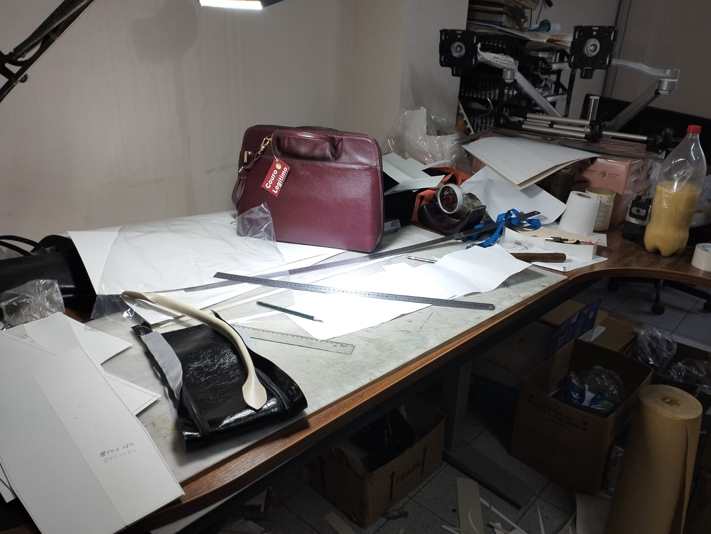
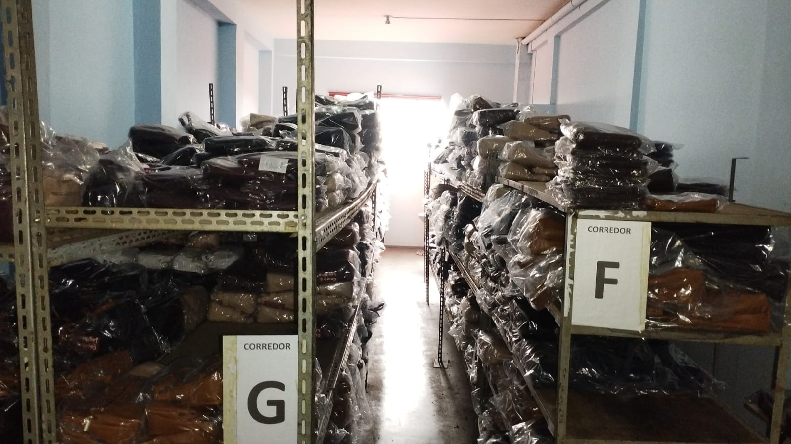
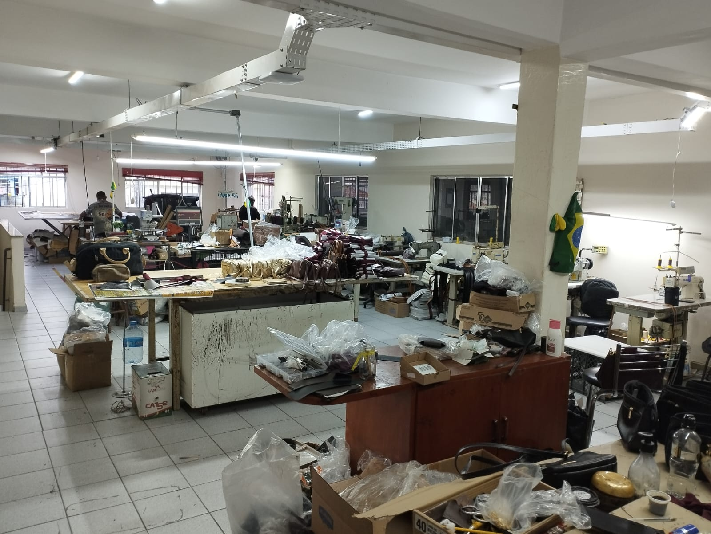
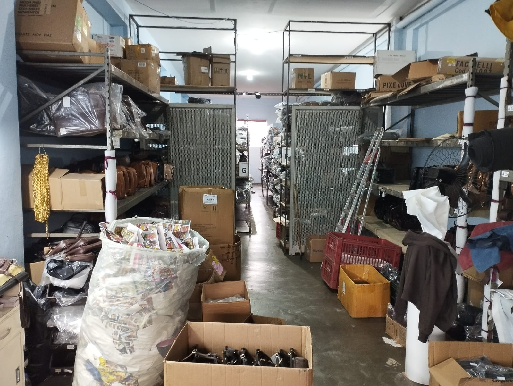
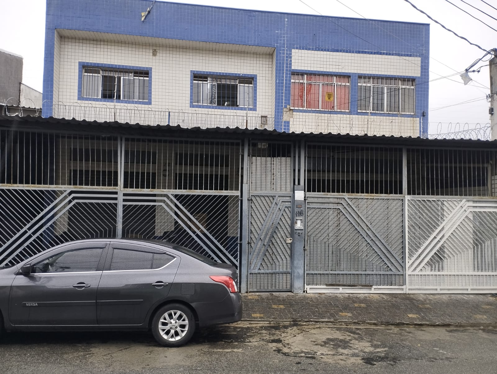

## Metadados

| Nome | RGM | Usuário do GitHub |
|---|---|---|
| Guilherme da Silva Ferreira Batista | 47302518 | dark60895-cpu |
| Guilherme Petrucelli Domingos | 47270161 | (a confirmar) |
| Jaime Luiz de Oliveira Neto | 47336951 | jaimelneto77-alt |
| Matheus Montagner | 47209470 | MatheusMontagner8 |
| Vinicius Marques de Melo | 47213426 | viniciusmarquesmelo |

---

## 1. Caracterização da Organização

- **Nome e natureza da organização:** Contrasti Bolsas e Acessórios Ltda — Indústria e Comércio de Bolsas e Acessórios de Couro, com fins lucrativos. Produção própria, com venda direta e por canais diversos (loja física, e-commerce, WhatsApp, representantes externos).
- **Porte (números):** equipe de 10 pessoas; volume de 50 a 70 pedidos por mês, com aumento nas datas comemorativas (Dia das Mães e Natal).
- **Escopo do sistema:** o banco de dados cobre todas as áreas da organização observadas no levantamento — compras/estoque, produção (chão de fábrica), vendas (todos os canais) e financeiro — não se restringe a um único setor, nem apenas às áreas dos problemas declarados (P1, P2) acima.
- **Problemas identificados (resolvidos pelo modelo):**
  - **P1 — Falta de rastreabilidade de insumo por fornecedor:** o estoque não registrava de qual fornecedor/lote cada insumo veio, dificultando o controle de cor/textura entre peças da mesma coleção. Resolvido por `LOTE_INSUMO` (Entrega 2).
  - **P2 — Cálculo de custo de produto sem padronização:** o custo de cada peça era calculado "no olho", sem lista de materiais formal. Resolvido por `FICHA_TÉCNICA`.
- **O que foi observado diretamente na visita (observação presencial):** oficina de costura com múltiplas máquinas, bancada de corte/produção, estoque segmentado entre insumos e produtos prontos, uso de facções terceirizadas para parte da produção, e processos de controle (estoque, produção) feitos manualmente/no papel (evidências fotográficas abaixo).
- **Entrevista — o que foi dito:** segundo Osmar Lingiard (responsável pela empresa), a equipe tem 10 pessoas, o volume de pedidos é de 50 a 70 por mês, e boa parte da dificuldade operacional vem de processos que ainda ficam só no papel, sem um sistema que registre e integre as informações — o controle de estoque, produção e vendas depende de anotações manuais, o que dificulta o acompanhamento e aumenta o risco de erro.
- **Entrevista — quem participou:** entrevistado: Osmar Lingiard (responsável pela empresa — vínculo: Dono). Pelo grupo: Guilherme da Silva Ferreira Batista, Guilherme Petrucelli Domingos, Jaime Luiz de Oliveira Neto, Matheus Montagner e Vinicius Marques de Melo.
- **Entrevista — data e local:** 14/09, nas instalações da Contrasti (Rua Alpiste, 116 - Jd. Eliane - São Paulo/SP).
- **Como o levantamento foi feito:** visita presencial às instalações (fotos abaixo) e entrevista com o responsável, complementada por questionário estruturado preenchido durante a conversa. Relato completo em [`levantamento/levantamento.md`](levantamento/levantamento.md).
- **Justificativa da escolha:** organização de acesso facilitado para o grupo, com processos observáveis em uma única visita — nem tão simples a ponto de não ter o que modelar, nem tão complexa a ponto de inviabilizar o levantamento no prazo da disciplina.
- **Evidências da organização:** Endereço: Rua Alpiste, 116 - Jd. Eliane - São Paulo - SP. Contato na empresa: Osmar Lingiard, telefone para contato: 11 97334-4846, email: osmar@specia.com.br. Fotos JPG/PNG da visita abaixo.

  
  
  

  
  
  

*Da esquerda para a direita, de cima para baixo: bancada de produção (corte/costura), escritório administrativo (espaço de trabalho do responsável pela empresa), estoque de bolsas prontas (corredor G), oficina com as máquinas de costura, estoque de insumos/materiais, fachada na Rua Alpiste.*

## 2. Processos de Negócio

**Visão geral do fluxo entre processos:** Compras (2/4) abastece a Produção (3/5), que abastece Vendas (6), que aciona Expedição (7); Compras e Vendas, por sua vez, geram lançamentos no Financeiro (8). Cadastro de clientes (1) é pré-requisito de Vendas (6).

1. **Cadastro e gestão de clientes** — Cadastro (dados, perfil varejo/atacado, múltiplos endereços) → Consulta de restrição de CPF/CNPJ → Aprovação de crédito quando o pagamento é a prazo (boleto) → cliente liberado para pedido. *Integra com:* Vendas (processo 6), que só abre pedido para cliente cadastrado e aprovado.
2. **Cadastro e gestão de fornecedores** — Cadastro (dados, categoria de insumo, prazo médio de entrega) → registro de cada compra recebida → atualização do histórico de avaliação (preço, variação, pontualidade). *Integra com:* Estoque/Compras (processo 4), que usa o fornecedor cadastrado para registrar cada lote recebido, e Financeiro (processo 8), que gera o título a pagar.
3. **Ficha técnica e cadastro de produtos** — Cadastro do modelo → definição das variações (SKU: cor × tipo de couro × ferragem) → montagem da lista de materiais (BOM/ficha técnica) → cálculo automático de custo e preço sugerido (ficha técnica + mão de obra + markup). *Integra com:* Estoque (consome o saldo de insumo listado na ficha técnica) e Vendas (fornece o preço base do produto).
4. **Gestão de estoque e compras** — Entrada de insumo por lote (XML de NF-e ou manual, com fornecedor e cor/tonalidade do lote) → atualização do saldo na unidade de medida correta → monitoramento de estoque mínimo com alerta → baixa automática na abertura de Ordem de Produção. *Integra com:* Fornecedores (processo 2, origem do lote), Produção (processo 5, consumo do insumo) e Financeiro (processo 8, título a pagar por lote).
5. **Ordem de produção e chão de fábrica** — Abertura de OP vinculada a um SKU → baixa automática do insumo necessário → execução por etapa (Modelagem → Corte → Preparação/Colagem → Costura → Montagem/Ferragens → Acabamento/Revisão → Embalagem), com Kanban e controle de aproveitamento de couro por etapa de corte → produto pronto disponível em estoque. *Integra com:* Ficha técnica (processo 3, o que consumir), Estoque (processo 4, baixa de insumo e alta de produto pronto) e remuneração de artesão pela etapa executada.
6. **Vendas, pedidos e faturamento** — Abertura do pedido por canal (loja física, e-commerce, WhatsApp, representante) → definição de forma de pagamento e congelamento do preço no item → faturamento e emissão de NF-e/NFC-e → cálculo de comissão do vendedor sobre o pedido faturado. *Integra com:* Cadastro de clientes (processo 1, pré-requisito), Estoque (processo 4, baixa de produto pronto), Expedição (processo 7, próximo passo) e Financeiro (processo 8, título a receber).
7. **Expedição e pós-venda** — Separação e conferência por código de barras (picking) → embalagem (checklist + dust bag) → envio com integração logística e rastreio → registro de troca/devolução/garantia (RMA) vinculado ao item efetivamente entregue. *Integra com:* Vendas (processo 6, pedido de origem) e Financeiro (processo 8, estorno em caso de devolução).
8. **Gestão financeira e relatórios gerenciais** — Geração automática de Contas a Pagar (a partir de cada lote de insumo recebido, processo 2/4) e Contas a Receber (a partir de cada pedido faturado, processo 6) → baixa conforme pagamento/recebimento → consolidação em indicadores gerenciais (Curva ABC, margem por produto, DRE, fluxo de caixa previsto × realizado). *Integra com:* todos os processos anteriores — é o ponto de encontro dos dois fluxos de caixa (compras e vendas).
  
**Processos prováveis não incluídos:** manutenção de máquinas e equipamentos de produção, gestão de recursos humanos/folha de pagamento da equipe interna e marketing/divulgação não aparecem como processos modelados — a entrevista e a observação presencial não registraram controle sistemático desses processos na Contrasti (a equipe interna é CLT, com folha tratada por contabilidade terceirizada, fora da gestão operacional da empresa), e nenhum deles é um problema de gestão de informação (P1/P2) nem foi citado como dificuldade pelo responsável.

---

## 3. Requisitos do Sistema

### 3.1 Requisitos Funcionais

| # | O sistema deve permitir... |
|---|---|
| RF01 | Cadastrar clientes com razão social/nome, CNPJ/CPF, inscrição estadual (quando lojista), e-mail para NF-e, telefone/WhatsApp, endereço completo (logradouro, número, bairro, cidade, UF, CEP) e comprador responsável.  |
| RF02 | Registrar múltiplos endereços por cliente (matriz, entrega, cobrança). |
| RF03 | Diferenciar clientes por perfil (Varejo Final × Atacado/Lojista) com regras de preço distintas. |
| RF04 | Consultar restrição de CPF/CNPJ e aplicar limite de crédito para boleto, exigindo aprovação financeira para novos lojistas. |
| RF05 | Cadastrar fornecedores com categoria de insumo, contato do vendedor e prazo médio de entrega. |
| RF06 | Registrar entrada de insumos por lote, vinculando fornecedor, cor/tonalidade e preço pago (rastreabilidade). |
| RF07 | Manter histórico de compras e avaliação por fornecedor (preço, variação, pontualidade de entrega). |
| RF08 | Cadastrar produtos por modelo e variação (SKU), combinando cor, tipo de couro e tipo de ferragem. |
| RF09 | Manter a Ficha Técnica (BOM) de cada SKU, com a quantidade de cada insumo necessária. |
| RF10 | Calcular automaticamente o custo total e sugerir preço de venda a partir da Ficha Técnica, mão de obra e markup. |
| RF11 | Registrar entrada de matéria-prima via XML de NF-e ou digitação manual. |
| RF12 | Controlar o estoque de insumos nas unidades apropriadas (dm²/m², unidade/metro, kg/L), com estoque mínimo e alerta automático. |
| RF13 | Baixar automaticamente o estoque de insumos na abertura da Ordem de Produção. |
| RF14 | Abrir Ordens de Produção vinculadas a um SKU e acompanhar o status em painel Kanban (Aguardando/Em Corte/Em Costura/Finalizado). |
| RF15 | Registrar, por etapa de produção, o artesão responsável e o percentual de aproveitamento/perda de couro na etapa de Corte. |
| RF16 | Registrar pedidos de venda por canal (loja física, e-commerce, WhatsApp, representante), com forma de pagamento e parcelamento. |
| RF17 | Calcular comissão de vendedores/representantes sobre pedidos faturados, com percentuais diferenciados por canal. |
| RF18 | Emitir NF-e (venda mercantil) e NFC-e (cupom varejo), nativamente ou por integração. |
| RF19 | Controlar separação, conferência (código de barras) e embalagem (checklist + dust bag) antes do envio. |
| RF20 | Integrar com serviços de logística (Correios, Melhor Envio, transportadoras parceiras) para etiquetas e rastreio. |
| RF21 | Registrar trocas, devoluções e garantias (RMA) vinculadas ao item efetivamente entregue. |
| RF22 | Gerar lançamentos automáticos de Contas a Receber (vendas faturadas) e Contas a Pagar (compras). |
| RF23 | Gerar relatórios gerenciais: Curva ABC, margem de lucro por modelo, DRE gerencial, fluxo de caixa previsto × realizado, estoque parado. |
| RF24 | Restringir o acesso por perfil de usuário (Vendedor, Gerente de Produção, Financeiro, Administrador). |

### 3.2 Requisitos Não Funcionais

| # | Característica de qualidade |
|---|---|
| RNF01 | **Desempenho:** consultas de estoque e ficha técnica devem responder rápido o suficiente para não atrasar a abertura de uma Ordem de Produção. |
| RNF02 | **Segurança:** controle de acesso por perfil (RF24) e proteção de dados pessoais de clientes/fornecedores (LGPD). |
| RNF03 | **Disponibilidade:** o módulo de estoque/OP precisa estar disponível no horário de produção, já que a baixa de insumo é automática e bloqueante. |
| RNF04 | **Usabilidade:** o painel Kanban de produção deve ser operável pelos artesãos/facções sem treinamento extenso. |
| RNF05 | **Integridade transacional:** baixa de estoque, geração de título financeiro e emissão de nota fiscal devem ocorrer de forma atômica (tudo ou nada). |
| RNF06 | **Auditabilidade:** histórico de preços por fornecedor e de status de OP deve ser preservado para consultas gerenciais futuras. |

**Requisitos prováveis não incluídos:** integração com marketplaces externos (Mercado Livre, Shopee), aplicativo mobile dedicado ao cliente final e controle de ponto/folha de pagamento da equipe interna não foram incluídos como requisitos, nenhum desses pontos foi relatado como necessidade pelo responsável, e marketplace/app mobile não fazem parte dos canais de venda reais da empresa.

---

## 4. Regras de Negócio

- **Regras operacionais:**
  - RN01 — Inscrição Estadual só é obrigatória quando o perfil do cliente é Atacado/Lojista.
  - RN02 — Toda variação de produto (SKU) pertence a exatamente um modelo; um modelo pode ter uma ou várias variações.
  - RN03 — A baixa de estoque de insumo ocorre automaticamente na abertura da Ordem de Produção (reserva de material necessário).
  - RN04 — Todo insumo recebido é registrado com lote e fornecedor de origem, para garantir rastreabilidade de cor/textura entre peças da mesma coleção.
  - RN05 — Comissão de vendedor: 3% para vendedor interno e 7% para representante externo, sobre pedidos faturados — percentual diferenciado por tipo de vínculo, já refletido na tabela VENDEDOR.
  - RN06 — Um chamado de garantia (RMA) está sempre associado a um item de pedido específico, nunca ao pedido inteiro.
  - RN07 — Um pedido só é expedido depois de checklist de saída e conferência dos itens (leitura de código de barras).

- **Restrições organizacionais:**
  - RN08 — Exigência legal de emissão de NF-e (venda mercantil) ou NFC-e (cupom fiscal varejo), conforme o canal de venda.
  - RN09 — Dados pessoais de clientes e fornecedores (nome, CPF/CNPJ, contato) exigem tratamento conforme a LGPD.
  - RN10 — O prazo médio de entrega de cada fornecedor impacta diretamente o planejamento da produção (lead time de insumo).
  - RN11 — O pagamento de artesãos/facções terceirizadas depende do registro fiel de qual etapa cada um executou — sem esse registro não há como calcular a remuneração por produção.

- **Regras de integridade verificadas por auditoria** (consultas A01-A07 do `script.sql`, Seção 9):
  - RN12 — `pedido.vl_total` deve sempre refletir a soma dos itens do pedido (denormalização controlada, não um erro — ver `RELATORIO_TECNICO.md` §1.4).
  - RN13 — Todo produto comercializado deve ter ficha técnica (BOM) completa.
  - RN14 — Todo insumo cadastrado deve estar vinculado a pelo menos uma ficha técnica ou lote recebido (sem cadastro órfão).
  - RN15 — A especialização de PRODUTO é Total e Disjunta: toda linha deve existir em exatamente uma das tabelas BOLSA/ACESSORIO.
  - RN16 — O preço praticado no item de pedido não deve variar mais que 10% do preço base vigente do produto sem justificativa (promoção/erro).
  - RN17 — Todo fornecedor cadastrado deve ter ao menos um lote de insumo recebido (cadastro ativo).
  - RN18 — Títulos financeiros vencidos e ainda "em aberto" devem ser sinalizados para cobrança/pagamento.

- **Regras prováveis não incluídas:** normas sanitárias (ANVISA) não se aplicam, pois a Contrasti não manipula alimentos; certificações ambientais/de origem sustentável do couro (ex.: selo LWG) não foram mencionadas pelo responsável como exigência atual da empresa ou de seus fornecedores, e por isso não foram modeladas como regra de negócio.

---

## 5. Diagrama Entidade-Relacionamento (DER)

**Arquivos anexados:** `Diagrama/Diagrama.png` (imagem, 17 entidades) e `Dicionario_de_Dados.html` (dicionário completo).

**Software utilizado:** a versão de 9 entidades foi desenhada diretamente no **BrModeloWeb**; esta versão final (17 entidades) foi regerada por script Python (biblioteca Pillow), seguindo manualmente as mesmas convenções visuais do BrModeloWeb (retângulo = entidade, losango = relacionamento, elipse = atributo com chave primária sublinhada em vermelho, triângulo "TD" = especialização), não mais por edição direta no aplicativo.

O diagrama segue a notação de Chen conceitual pura: entidades como **retângulos**, relacionamentos como **losangos** rotulados com o verbo, atributos como **elipses** (chave primária sublinhada, em vermelho). A especialização PRODUTO → BOLSA/ACESSÓRIO usa o triângulo "TD" (Total e Disjunta). **Toda aresta de relacionamento traz o rótulo `mínimo,máximo` nas duas pontas** — a versão anterior só mostrava 1/N na imagem (apesar de o Dicionario_de_Dados.html já declarar (1,1)/(0,N)), inconsistência apontada pelo professor como a maior deficiência da entrega (Critério 10, -0,40).

Este recorte de 17 entidades cobre, os módulos: produção detalhada (ORDEM_PRODUÇÃO, ETAPA_PRODUÇÃO, ARTESÃO, EXECUÇÃO_ETAPA — Seção 2, processo 5), recebimento rastreável de insumo (LOTE_INSUMO — Seção 2, processo 4) e financeiro básico (CONTAS_PAGAR, CONTAS_RECEBER — Seção 2, processo 8), além de VENDEDOR para sustentar a regra de comissão por canal (Seção 4).

---

## 6. Justificativa Técnica

- **Por que 17 entidades:** a versão de 9 entidades modelava apenas o núcleo de custo e venda, mas o professor apontou que ORDEM_PRODUÇÃO e um mecanismo de lote de insumo eram **ausências essenciais** — sem eles, os processos de produção e de rastreabilidade de compra já descritos na Seção 2 não tinham onde ser registrados no modelo. As 6 entidades desejáveis (ETAPA_PRODUÇÃO, ARTESÃO, EXECUÇÃO_ETAPA, VENDEDOR, CONTAS_RECEBER, CONTAS_PAGAR) foram incorporadas porque o grupo já tinha a regra de negócio correspondente documentada (Seção 4) sem entidade que a sustentasse.
- **Por que LOTE_INSUMO substitui a relação direta FORNECEDOR–INSUMO:** a versão anterior modelava FORNECEDOR–INSUMO como (1,1), ou seja, cada insumo vinha de um único fornecedor fixo — o professor apontou que isso contradiz a própria regra de rastreabilidade por lote (Seção 4), já que, na prática, um mesmo insumo (ex.: couro caramelo) pode ser recebido de fornecedores diferentes em momentos diferentes, cada lote com sua cor/tonalidade. LOTE_INSUMO resolve isso: liga-se a exatamente um INSUMO e a exatamente um FORNECEDOR por recebimento, permitindo múltiplos lotes (e múltiplos fornecedores) para o mesmo insumo ao longo do tempo.
- **Por que FICHA_TÉCNICA, LOTE_INSUMO, EXECUÇÃO_ETAPA e ITEM_PEDIDO como entidades associativas com chave própria:** todas carregam atributos próprios que não pertencem a nenhuma das entidades que conectam (qt_necessaria; nr_lote/qt_recebida/vl_preco_pago; pc_aproveitamento/pc_perda; qt_quantidade/vl_preco_unitario/vl_subtotal) — a notação exige reificá-las como entidade. Nesta revisão, cada uma recebeu uma chave primária própria (ex.: `id_ficha`) em vez da chave composta por FKs que a versão anterior usava em FICHA_TÉCNICA (`produto_id (PK, FK)` + `insumo_id (PK, FK)`) — apontado pelo professor como agravante, por misturar um detalhe de implementação (FK) com a identidade conceitual da entidade.
- **Por que PRODUTO como supertipo (BOLSA/ACESSÓRIO):** bolsa e acessório compartilham identificador, nome, descrição, preço base, categoria e estoque — mas cada um tem atributos exclusivos (tamanho/tipo_alça para bolsa; tipo_acessorio/compatibilidade para acessório). Generalização/especialização evita repetir os atributos comuns em duas entidades soltas e ainda documenta, no próprio diagrama, que um produto é sempre um dos dois (TD).
- **Por que nenhuma FK aparece mais no diagrama conceitual:** a versão anterior marcava FKs explicitamente dentro das entidades, como antecipação deliberada do modelo lógico. O professor foi claro que isso não é adequado a um DER conceitual, mesmo quando deliberado — FK é resultado da conversão para o modelo lógico (como já documentado em `Entrega2/modelo_logico.md`), não um atributo do conceitual. O diagrama atual não tem nenhuma FK; a correspondência entre entidades associativas e suas referências continua explícita pelos próprios relacionamentos (losangos) do DER.
- **Alternativas descartadas:** cogitou-se manter BOLSA e ACESSÓRIO como uma única entidade PRODUTO com campos opcionais — descartado porque misturaria atributos obrigatórios de um subtipo com atributos irrelevantes do outro. Para LOTE_INSUMO, cogitou-se apenas adicionar um atributo multivalorado de "fornecedores" a INSUMO — descartado porque um atributo multivalorado não teria onde guardar data, quantidade e preço de cada recebimento individual; só uma entidade própria resolve isso.
  
### 6.1 Apontamento da correção (Caso A — mesma organização da Entrega 1)

| Apontamento da correção E1 | O que mudou no trabalho | Por quê |
|---|---|---|
| DER com apenas 9 entidades, sem ORDEM_PRODUÇÃO nem mecanismo de lote de insumo | DER reconstruído para 17 entidades, incluindo ORDEM_PRODUÇÃO, ETAPA_PRODUÇÃO, ARTESÃO, EXECUÇÃO_ETAPA, LOTE_INSUMO, VENDEDOR, CONTAS_RECEBER e CONTAS_PAGAR | Sem essas entidades, os processos de produção e de rastreabilidade de insumo já descritos na Seção 2 não tinham onde ser registrados no modelo (Critério 10, -0,40) |
| Relação direta FORNECEDOR–INSUMO (1,1), como se cada insumo viesse de um único fornecedor fixo | Substituída por FORNECEDOR–LOTE_INSUMO–INSUMO | Contradizia a própria regra de rastreabilidade por lote (Seção 4): na prática, o mesmo insumo pode ser recebido de fornecedores diferentes em lotes diferentes |
| Cardinalidades no diagrama mostrando só `1`/`N`, sem o mínimo explícito | Todas as 16 relações passaram a exibir `mínimo,máximo` nas duas pontas | Apontado como a maior deficiência da entrega (Critério 10, -0,40) — a notação estava incompleta mesmo com o dicionário já declarando os valores corretos |
| FICHA_TÉCNICA com chave composta por FKs (`produto_id (PK,FK)` + `insumo_id (PK,FK)`) | Chave própria (`id_ficha`) substituiu a chave composta | Misturava um detalhe de implementação (FK) com a identidade conceitual da entidade — agravante apontado pelo professor |
| Marcação `(FK)` presente dentro das entidades do DER conceitual | Toda marcação de FK foi removida do diagrama | FK é resultado da conversão para o modelo lógico (`Entrega2/modelo_logico.md`), não um atributo do conceitual |
| Dicionário de dados sem SGBD/collation, tipo físico, índices sugeridos, log de acesso nem matriz de acesso/LGPD | Dicionário HTML reescrito do zero com essas seções | Critério Dicionário (-0,20) respondia, junto com o DER, por mais de um terço da nota máxima perdida |
| Seção 1 com linguagem condicional ("sugerem", "prováveis de estarem") sem separar fato de inferência | Linguagem revisada para distinguir explicitamente o que foi observado do que ainda está pendente de confirmação | O professor pediu precisão sobre o que é levantamento direto versus suposição do grupo |

---

## 7. Uso de Inteligência Artificial

| Item | Registro |
|---|---|
|  **Ferramenta e etapa** | Claude (Claude Code / Sonnet 5, Anthropic) — usado em oito momentos: (1) leitura do questionário de requisitos e construção de um primeiro modelo conceitual (21 entidades) e dicionário de dados; (2) geração de um primeiro diagrama ER (notação "pé-de-galinha"); (3) preenchimento deste README a partir do esqueleto oficial da Entrega 1; (4) reconstrução desse primeiro diagrama na notação de Chen usada pelo BrModeloWeb, a pedido explícito do professor; (5) depois que o grupo (Guilherme) remodelou o DER para um recorte mais enxuto de 9 entidades direto no BrModeloWeb, reorganização do dicionário HTML já produzido pelo grupo e reescrita das Seções 5–8 para descrever esse modelo; (6) substituição do diagrama do repositório pela versão corrigida que o grupo enviou (PDF exportado do BrModeloWeb, com nomes de atributo, PKs/FKs e cardinalidades revisados), com o dicionário HTML e as Seções 5–8 atualizados para bater com essa versão; (7) a pedido do grupo, correção pontual de duas cardinalidades da própria imagem do diagrama ("compõe" e "detalha", ao redor de FICHA_TÉCNICA) para o padrão 1:N esperado de uma entidade associativa, e atualização do dicionário HTML e do README para refletir a correção; (8) **em resposta à avaliação formal do professor na [issue #1](https://github.com/matheusmontagner8/Modelagem-de-Dados/issues/1)**, reconstrução completa do DER (de 9 para 17 entidades, cardinalidade mínima e máxima em todas as 16 relações, remoção de toda marcação de FK do diagrama, troca da chave composta de FICHA_TÉCNICA por chave própria, inclusão de ORDEM_PRODUÇÃO e LOTE_INSUMO), reescrita completa do dicionário de dados em HTML (convenções, SGBD/collation/prefixos, expressão formal, tipo físico, índices sugeridos, log de acesso e matriz de acesso por operação/LGPD) e revisão das Seções 1, 2, 4, 5 e 6 deste README para refletir o modelo corrigido. |  
| **Motivação** | Acelerar a tradução do levantamento de requisitos para um modelo estruturado e para o formato de entrega exigido pela disciplina; depois, manter o README, o diagrama e o dicionário sempre consistentes entre si; corrigir duas cardinalidades que a própria IA havia sinalizado como pouco usuais, com autorização explícita do grupo; por fim, responder item a item à avaliação formal do professor, corrigindo exatamente o que foi apontado como ausente ou inconsistente, sem contestar os pontos levantados. |
| **Prompt(s) utilizados** | 1. "Preciso montar um diagrama e o dicionário desse diagrama, como se fosse no modelo BrModeloWeb..." 2. "Consegue gerar um arquivo pdf com esse arquivo que montou? Contendo somente o diagrama e o dicionário" 3. "adicione essas fotos no readme, na parte de evidências" 4. "De acordo com o dicionário e o diagrama que estão agora, crie o arquivo de dicionário de dados em html" 5. "Arrume o diagrama para esse pdf, agora ele está correto. No readme faça todas as correções necessárias, de acordo com esse diagrama novo e finalizado" 6. "Pode ajustar" (autorizando a correção das cardinalidades sinalizadas). | 
| **Resposta recebida** | Um primeiro modelo (21 entidades); o DER redesenhado em notação de Chen; a troca do diagrama de 9 entidades pela versão corrigida enviada pelo grupo, com dicionário e README reescritos atributo a atributo; a edição direta dos pixels do PNG para duas cardinalidades pontuais; e, nesta última etapa, um DER inteiramente regerado por script (não mais edição de pixel) — 17 entidades, 16 relacionamentos com `mínimo,máximo` nas duas pontas, sem nenhuma FK — mais o dicionário HTML reescrito do zero (convenções, tipo físico, índices, log de acesso, matriz LGPD) e as Seções 1, 2, 4–6 deste README revisadas. |
| **Fontes consultadas e verificadas** | Nenhuma fonte externa em nenhuma das seis etapas. Nesta última, a única fonte foi o corpo da issue #1 do próprio repositório (avaliação literal do professor, obtida via `gh api repos/.../issues/1`), usada como lista de verificação exaustiva do que corrigir. |
| **Trechos rejeitados ou corrigidos** | Histórico completo nas etapas 1–7 acima. Nesta etapa (8): a relação direta FORNECEDOR–INSUMO (1,1) foi substituída por FORNECEDOR–LOTE_INSUMO–INSUMO, porque contradizia a regra de rastreabilidade por lote; a chave composta de FICHA_TÉCNICA (`produto_id (PK,FK)` + `insumo_id (PK,FK)`) foi substituída por `id_ficha` próprio; toda marcação `(FK)` foi removida das entidades; os rótulos de cardinalidade, que só mostravam `1`/`N`, passaram a mostrar sempre `mínimo,máximo`; a linguagem condicional da Seção 1 ("sugerem", "prováveis de estarem") foi substituída por uma separação explícita entre o que foi observado e o que ainda está pendente de confirmação; a legenda "Jaime no escritório" (ambígua frente ao nome do arquivo "responsável") foi trocada por uma descrição neutra do ambiente fotografado. |
| **Justificativa da escolha final** | O DER e o dicionário agora atacam diretamente os dois critérios de maior peso reprovados na avaliação (DER, -0,40; Dicionário, -0,20), que juntos respondiam por mais de um terço da nota máxima possível. A Seção 1 e a Seção 2 foram ajustadas para os critérios parciais que o grupo podia corrigir sem nova coleta de dados (linguagem de inferência; fluxo/integração dos processos). O número de pessoas na equipe e o relato da dificuldade operacional (também citados como lacuna no Critério 4) foram preenchidos nesta revisão, a partir de um contato posterior do grupo com a organização, equipe de 10 pessoas e dificuldade concentrada em processos que ainda ficam só no papel. |
| **Reflexão crítica** | O professor observou, nas Observações da issue #1, que a IA produziu praticamente todo o trabalho (modelo, README, dicionário) nesta entrega, incluindo a edição direta dos pixels do PNG do DER em uma etapa anterior. Essa observação é correta e continua valendo: a reconstrução do DER, a reescrita do dicionário e a revisão do README foram majoritariamente executadas pela IA, com o grupo autorizando e direcionando cada etapa (abertura desta correção, confirmação de que o diagrama regenerado estava satisfatório), mas sem reescrever o conteúdo manualmente. O grupo deve se apropriar ativamente deste material antes de uma eventual reapresentação, relendo cada entidade nova (ORDEM_PRODUÇÃO, LOTE_INSUMO, EXECUÇÃO_ETAPA etc.), cada regra de negócio e cada cardinalidade, para conseguir defendê-los oralmente. |

---

# Entrega 2 — Modelo Lógico, Modelo Físico e Implementação SQL

**As três etapas da modelagem, e onde cada uma está neste repositório:** Conceitual (independente de SGBD, Entrega 1 — Seções 1-7 acima e `Diagrama/Diagrama.png`) → Lógico (tabelas/colunas/PK-FK/normalização, Seções 1.2–1.4 abaixo e `Entrega2/modelo_logico.md`) → **Físico** (implementação executável num SGBD real, com tipos, índices e constraints exatos do MySQL 8.4 — `Entrega2/script.sql`, testado em servidor real).

## 1.1 Revisão do Modelo Conceitual

O DER da Entrega 1 (`Diagrama/Diagrama.png`) **foi reconstruído** nesta etapa, em resposta à avaliação do professor: de 9 para 17 entidades e de 6 para 16 relacionamentos, todos agora com cardinalidade mínima e máxima em ambas as pontas, sem nenhuma marcação de FK no diagrama. O detalhamento completo dessa correção está nas Seções 5–7 acima e no `Dicionario_de_Dados.html`; esta seção parte diretamente do modelo já corrigido.

Oito entidades novas entraram no recorte: duas essenciais (`ORDEM_PRODUCAO`, `LOTE_INSUMO`) e seis desejáveis (`ETAPA_PRODUCAO`, `ARTESAO`, `EXECUCAO_ETAPA`, `VENDEDOR`, `CONTAS_RECEBER`, `CONTAS_PAGAR`). A conversão lógica abaixo cobre as 17.

As evidências da organização (fotos, endereço, contato) seguem as mesmas da Entrega 1, pois não houve nova visita de campo nesta etapa.

---

## 1.2 Conversão do Modelo Conceitual para o Modelo Lógico

### Entidades → Tabelas

Cada uma das 17 entidades do DER virou uma tabela. A especialização PRODUTO → BOLSA/ACESSÓRIO segue a estratégia tabela por subtipo: PRODUTO guarda os atributos comuns, e BOLSA/ACESSÓRIO guardam só os atributos exclusivos de cada subtipo, com a própria chave primária de PRODUTO reaproveitada como chave primária e estrangeira (`id_produto`). Essa é a estratégia mais fiel à especialização Total e Disjunta (TD) do DER: ela evita colunas que ficariam sempre nulas para um dos dois subtipos e não perde a identidade comum de PRODUTO.

| Entidade conceitual | Tabela(s) lógica(s) |
|---|---|
| FORNECEDOR | `fornecedor` |
| INSUMO | `insumo` |
| LOTE_INSUMO | `lote_insumo` |
| FICHA_TÉCNICA | `ficha_tecnica` |
| PRODUTO | `produto` |
| BOLSA | `bolsa` |
| ACESSÓRIO | `acessorio` |
| ORDEM_PRODUÇÃO | `ordem_producao` |
| ETAPA_PRODUÇÃO | `etapa_producao` |
| ARTESÃO | `artesao` |
| EXECUÇÃO_ETAPA | `execucao_etapa` |
| CLIENTE | `cliente` |
| VENDEDOR | `vendedor` |
| PEDIDO | `pedido` |
| ITEM_PEDIDO | `item_pedido` |
| CONTAS_RECEBER | `contas_receber` |
| CONTAS_PAGAR | `contas_pagar` |

### Atributos → Colunas

Os atributos do dicionário de dados da Entrega 1 viraram colunas com tipo de dado explícito e nome prefixado (`id_`/`nm_`/`ds_`/`dt_`/`vl_`/`qt_`/`pc_`/`tp_`/`nr_`/`un_` — mesma convenção do `Dicionario_de_Dados.html`). Decisões de tipagem que valem registro:

- `vl_*` (preços, valores de título) → `DECIMAL(10,2)` (nunca `FLOAT`/`DOUBLE`, para não acumular erro de arredondamento em valor monetário).
- `qt_necessaria`, `qt_recebida` (lote/ficha técnica) → `DECIMAL(10,3)`, uma casa decimal a mais que valores monetários, porque quantidades de insumo (metros de linha, m² de couro) usam frações mais finas que centavos.
- `pc_aproveitamento`, `pc_perda`, `pc_comissao` → `DECIMAL(5,2)`, suficiente para um percentual com duas casas.
- Atributos de domínio fechado (`tp_categoria`, `un_medida`, `tp_produto`, `tp_status`, `tp_pagamento`, `tp_canal`, `tp_status_kanban`, `tp_vinculo`) viraram `VARCHAR` com `CHECK ... IN (...)` em vez de tabelas de domínio separadas — domínios pequenos e estáveis (3 a 6 valores fixos), exceto `ETAPA_PRODUCAO`, que **é** uma tabela de domínio própria porque também carrega a ordem sequencial do processo produtivo (`nr_ordem_sequencial`), um dado que não cabe num `CHECK`.

### Relacionamentos → Chaves

| Relacionamento conceitual | Tradução no modelo lógico |
|---|---|
| FORNECEDOR (1,1) — fornece — (0,N) LOTE_INSUMO | `lote_insumo.fornecedor_id` → FK para `fornecedor.id_fornecedor` |
| INSUMO (1,1) — é_recebido_como — (0,N) LOTE_INSUMO | `lote_insumo.insumo_id` → FK para `insumo.id_insumo` |
| LOTE_INSUMO (1,1) — gera — (0,N) CONTAS_PAGAR | `contas_pagar.lote_id` → FK para `lote_insumo.id_lote` |
| PRODUTO (1,1) — é_detalhado_em — (0,N) FICHA_TÉCNICA | `ficha_tecnica.produto_id` → FK para `produto.id_produto` |
| INSUMO (1,1) — compõe — (0,N) FICHA_TÉCNICA | `ficha_tecnica.insumo_id` → FK para `insumo.id_insumo` |
| PRODUTO (1,1) — é_produzido_em — (0,N) ORDEM_PRODUÇÃO | `ordem_producao.produto_id` → FK para `produto.id_produto` |
| ORDEM_PRODUÇÃO (1,1) — se_desdobra_em — (0,N) EXECUÇÃO_ETAPA | `execucao_etapa.op_id` → FK para `ordem_producao.id_op` |
| ETAPA_PRODUÇÃO (1,1) — classifica — (0,N) EXECUÇÃO_ETAPA | `execucao_etapa.etapa_id` → FK para `etapa_producao.id_etapa` |
| ARTESÃO (1,1) — realiza — (0,N) EXECUÇÃO_ETAPA | `execucao_etapa.artesao_id` → FK para `artesao.id_artesao` |
| PRODUTO — TD — BOLSA / ACESSÓRIO | `bolsa.id_produto` e `acessorio.id_produto` → FK para `produto.id_produto`, e também PK de cada subtipo |
| CLIENTE (1,1) — realiza — (0,N) PEDIDO | `pedido.cliente_id` → FK para `cliente.id_cliente` |
| VENDEDOR (1,1) — atende — (0,N) PEDIDO | `pedido.vendedor_id` → FK para `vendedor.id_vendedor` |
| PEDIDO (1,1) — contém — (1,N) ITEM_PEDIDO | `item_pedido.pedido_id` → FK para `pedido.id_pedido` |
| PRODUTO (1,1) — é_vendido_em — (0,N) ITEM_PEDIDO | `item_pedido.produto_id` → FK para `produto.id_produto` |
| PEDIDO (1,1) — gera — (0,N) CONTAS_RECEBER | `contas_receber.pedido_id` → FK para `pedido.id_pedido` |

Regra geral aplicada: em todo relacionamento 1:N, a chave estrangeira migra para a tabela do lado "N". Diferente da Entrega 1 original, **nenhuma dessas FKs aparece no DER conceitual**, elas só existem a partir desta conversão lógica.

### Cardinalidades

- **1:N** (a maioria dos relacionamentos do modelo) → FK simples na tabela do lado N, `NOT NULL` em todos os casos, porque toda cardinalidade mínima do lado 1 no DER corrigido é (1,1).
- **N:N** — não existe nenhum relacionamento N:N puro neste modelo; todas as associações com atributo próprio (`lote_insumo`, `ficha_tecnica`, `execucao_etapa`, `item_pedido`) já nasceram como entidades associativas desde o conceitual.
- **1:1** (especialização TD) → chave primária compartilhada entre `produto` e `bolsa`/`acessorio`, com `ON DELETE CASCADE`.

---

## 1.3 Definição de Chaves Primárias e Estrangeiras

| Tabela | Chave Primária (PK) | Chaves Estrangeiras (FK) |
|---|---|---|
| `fornecedor` | `id_fornecedor` | — |
| `insumo` | `id_insumo` | — |
| `lote_insumo` | `id_lote` | `insumo_id` → `insumo.id_insumo`; `fornecedor_id` → `fornecedor.id_fornecedor` |
| `produto` | `id_produto` | — |
| `bolsa` | `id_produto` | `id_produto` → `produto.id_produto` |
| `acessorio` | `id_produto` | `id_produto` → `produto.id_produto` |
| `ficha_tecnica` | `id_ficha` | `produto_id` → `produto.id_produto`; `insumo_id` → `insumo.id_insumo` |
| `ordem_producao` | `id_op` | `produto_id` → `produto.id_produto` |
| `etapa_producao` | `id_etapa` | — |
| `artesao` | `id_artesao` | — |
| `execucao_etapa` | `id_execucao` | `op_id` → `ordem_producao.id_op`; `etapa_id` → `etapa_producao.id_etapa`; `artesao_id` → `artesao.id_artesao` |
| `cliente` | `id_cliente` | — |
| `vendedor` | `id_vendedor` | — |
| `pedido` | `id_pedido` | `cliente_id` → `cliente.id_cliente`; `vendedor_id` → `vendedor.id_vendedor` |
| `item_pedido` | `id_item_pedido` | `pedido_id` → `pedido.id_pedido`; `produto_id` → `produto.id_produto` |
| `contas_receber` | `id_titulo_receber` | `pedido_id` → `pedido.id_pedido` |
| `contas_pagar` | `id_titulo_pagar` | `lote_id` → `lote_insumo.id_lote` |

---

## 1.4 Processo de Normalização (1FN, 2FN e 3FN)

### 1FN — eliminação de grupos repetitivos/atributos multivalorados

Nenhuma tabela tem coluna multivalorada ou grupo repetitivo. O endereço de `fornecedor` e `cliente` é decomposto em `ds_logradouro`/`nr_numero`/`ds_bairro`/`nm_cidade`/`sg_uf`/`nr_cep` — não é guardado como uma única string livre, para permitir filtrar/agrupar por cidade, UF ou bairro quando necessário (ex.: logística de entrega por região).

### 2FN — eliminação de dependências parciais

2FN só é uma preocupação real em tabelas com **chave composta** — e, nesta versão, nenhuma tabela tem PK composta (a antiga `ficha_tecnica` foi a exceção na v1; ver Seção 1.3). Todas as tabelas têm PK simples (uma coluna gerada), então 2FN é satisfeita trivialmente em todo o modelo.

### 3FN — eliminação de dependências transitivas

Todas as colunas não-chave de cada tabela dependem diretamente da PK, com duas exceções **deliberadas**:

1. **`pedido.vl_total`** — formalmente calculável a partir de outra tabela (`SUM(item_pedido.vl_subtotal)` para aquele pedido). O grupo optou por mantê-lo como coluna própria (denormalização controlada), por dois motivos: (a) já estava no Dicionário de Dados desde a Entrega 1, e (b) consultas gerenciais de faturamento são executadas com muito mais frequência do que pedidos são alterados. Para não deixar a denormalização "solta": a carga de dados e a Seção 6 (UPDATE) do script recalculam `vl_total` a partir da soma real dos itens, e a consulta A01 (auditoria) detecta qualquer pedido fora de sincronia.
2. **`insumo.qt_estoque_atual`** — na prática, um agregado do que entrou via `lote_insumo` menos o que foi consumido pela produção. Mantido como coluna própria pelo mesmo motivo do item anterior (consulta de estoque é operação frequente e não pode depender de somar todo o histórico de lotes a cada leitura); a atualização fica a cargo da aplicação/rotina de baixa (RF13), fora do escopo deste script de demonstração.

`item_pedido.vl_subtotal`, por outro lado, **não** tem esse problema: é `GENERATED ALWAYS AS (...) STORED`, calculado pelo próprio SGBD a partir de colunas da mesma linha — nunca pode ficar inconsistente.

---

## 1.5 Justificativas Técnicas das Decisões

- **Chaves primárias:** surrogate (`AUTO_INCREMENT`) em toda tabela, inclusive `ficha_tecnica` (ver Seção 1.3) — nenhum atributo natural é garantidamente estável e único ao longo do tempo, e CNPJ/CPF não foram usados como PK para não propagar um dado sensível (protegido por LGPD) como chave estrangeira em outras tabelas.
- **Chaves estrangeiras:** todas as FKs do modelo lógico correspondem 1:1 às linhas da tabela de relacionamentos do Dicionario_de_Dados.html — nenhuma FK foi criada "a mais"; cada uma implementa exatamente um relacionamento do DER corrigido.
- **Restrições de obrigatoriedade/unicidade:** `UNIQUE` em `fornecedor.nr_cnpj`, `cliente.nr_cpf`, `cliente.nr_cnpj`, `ordem_producao.nr_op` e `etapa_producao.nr_ordem_sequencial`. `NOT NULL` em toda coluna que o dicionário descreve como obrigatória.
- **Valores permitidos (`CHECK`):** todo atributo de domínio fechado do dicionário virou `CHECK ... IN (...)` — o banco recusa a linha mesmo se alguém inserir direto via SQL.
- **`ON DELETE CASCADE`:** em `bolsa`, `acessorio`, `ficha_tecnica`, `item_pedido` e `execucao_etapa` — se o "todo" (produto, pedido, ordem de produção) for excluído, não faz sentido manter órfãs as linhas que o detalham. Já `insumo`, `cliente`, `fornecedor`, `lote_insumo`, `etapa_producao`, `artesao`, `pedido` e `vendedor` **não** têm cascade a partir deles — excluir, por exemplo, um fornecedor não deveria apagar silenciosamente o histórico de lotes recebidos dele (é um erro operacional que o banco deve barrar, não propagar).
- **`LOTE_INSUMO` em vez de FK direta `insumo.fornecedor_id`:** a versão anterior prendia cada insumo a um único fornecedor fixo, contradizendo a própria regra de rastreabilidade por lote (um mesmo insumo pode ser recebido de fornecedores diferentes). A consulta 5.4 do script demonstra isso: "Bolsa Tote Caramelo" usa couro recebido de **dois** fornecedores diferentes (Curtume Vaqueta Ouro e Curtume Linhares Couros).
- **Triggers de exclusividade (`trg_bolsa_exclusividade_ins`, `trg_acessorio_exclusividade_ins`):** a estratégia tabela-por-subtipo não deixa o SGBD garantir sozinho a especialização Total e Disjunta. Os triggers impedem, em tempo real, que o mesmo `id_produto` entre em `bolsa` e `acessorio` ao mesmo tempo; a totalidade (todo produto tem que ter uma linha em algum dos dois) não é checável por trigger de inserção e por isso continua coberta pela auditoria A04.
- **Decisões arquiteturais gerais:** o modelo ficou com 17 tabelas, o mesmo número de entidades do conceitual corrigido — nenhuma tabela associativa nova foi necessária além das já previstas no DER, e a especialização TD seguiu com tabela-por-subtipo.

---

## 1.6 Proposta de Arquitetura Analítica para BI e IA

### Informações estratégicas extraíveis dos dados

- Faturamento por período, canal (loja física/e-commerce/atacado) e categoria de produto.
- Composição de custo de cada peça (matéria-prima via `ficha_tecnica` × `insumo.vl_preco_referencia`) versus preço praticado — margem real por produto.
- Consumo de insumos projetado a partir das vendas, para antecipar reposição junto aos fornecedores certos (via `lote_insumo`, agora com histórico multi-fornecedor).
- Concentração de receita por cliente e comissão devida por vendedor/canal (consultas G04 e 5.7 do script).
- Produtividade e qualidade por etapa de produção: aproveitamento/perda de couro por artesão na etapa de Corte (consulta G06).
- Saúde financeira: aging de títulos a pagar/receber em aberto (consultas G07 e A07).

### Problemas e KPIs — rastreabilidade (problema/KPI → tabelas → consulta)

Dois problemas operacionais identificados na Entrega 1 (Seção 1 acima) e nove indicadores gerenciais, cada um com a consulta do `script.sql` que o resolve ou calcula — consulta que não aparece aqui não conta como KPI.

| Problema ou KPI | Tabelas envolvidas | Consulta |
|---|---|---|
| P1 — Falta de rastreabilidade de insumo por fornecedor | `LOTE_INSUMO`, `INSUMO`, `FORNECEDOR` | G09 |
| P2 — Cálculo de custo de produto sem padronização | `FICHA_TECNICA`, `INSUMO`, `PRODUTO` | G03 |
| K1 — Faturamento mensal | `PEDIDO` | G01 |
| K2 — Produtos mais vendidos (Curva ABC) | `ITEM_PEDIDO`, `PRODUTO` | G02 |
| K3 — Margem por produto | `PRODUTO`, `FICHA_TECNICA`, `INSUMO` | G03 |
| K4 — Concentração de receita por cliente | `CLIENTE`, `PEDIDO` | G04 |
| K5 — Consumo de insumo projetado | `ITEM_PEDIDO`, `FICHA_TECNICA`, `INSUMO` | G05 |
| K6 — Aproveitamento de corte por artesão | `EXECUCAO_ETAPA`, `ETAPA_PRODUCAO`, `ARTESAO` | G06 |
| K7 — Aging de títulos a pagar/receber | `CONTAS_RECEBER`, `CONTAS_PAGAR` | G07 |
| K8 — Insumos abaixo do estoque mínimo | `INSUMO` | G08 |
| K9 — Comissão por vendedor/canal | `PEDIDO`, `VENDEDOR` | G10 |

**KPIs propostos para expansão futura** (ainda sem consulta implementada, por isso fora da rastreabilidade acima): giro de estoque por produto, dependência por fornecedor, taxa de cancelamento de pedidos.

### Potencial dos dados para BI

A estrutura normalizada (fatos em `pedido`/`item_pedido`/`execucao_etapa`, dimensões em `cliente`/`vendedor`/`produto`/`insumo`/`fornecedor`/`artesao`) já se parece com um esquema estrela simplificado, com dois processos de negócio representados (vendas e produção). As consultas gerenciais G01-G10 do script já são, na prática, protótipos de dashboards.

### Aplicações analíticas e de IA

- **Previsão de demanda:** série histórica de `item_pedido.qt_quantidade` por produto/mês, para antecipar compra de insumos sazonais (Dia das Mães, Natal).
- **Recomendação:** padrão de coocorrência de produtos no mesmo pedido, para sugestão de combos.
- **Detecção de anomalia de preço:** a consulta de auditoria A05 (limiar fixo de 10%) poderia evoluir para um modelo estatístico (desvio padrão por categoria).
- **Previsão de aproveitamento de corte:** a série de `execucao_etapa.pc_aproveitamento` por artesão (consulta G06) já dá histórico suficiente para um modelo simples de produtividade esperada por profissional, útil tanto para planejamento de produção quanto para conferência do pagamento por etapa.
- **Classificação de risco de crédito:** se o atributo de perfil/crédito do cliente (presente no levantamento de requisitos original, mas fora do recorte modelado) for incorporado em uma iteração futura, os dados de `pedido`/`contas_receber` já dão histórico suficiente (incluindo atraso de pagamento) para treinar um modelo simples de propensão a atraso.

---

### Volume da massa de dados e sua relação com o porte real

A massa de dados fictícia do `script.sql` foi dimensionada a partir do porte declarado pela organização (Seção 1: equipe de 10 pessoas, 50-70 pedidos/mês), não de forma arbitrária:

- **109 pedidos** — equivalente a pouco menos de 2 meses de operação no volume real informado (50-70/mês). Os meses simulados não são uniformes de propósito: abril/maio têm só 15 pedidos "de estrutura" (o suficiente para testar o modelo sem inflar o volume à toa), enquanto setembro foi gerado com 62 pedidos — dentro da faixa real de um mês cheio — para servir de base realista às consultas gerenciais.
- **43 clientes** (40 ativos + 3 recém-cadastrados, ainda sem compra) — compatível com a carteira de uma indústria desse porte, cobrindo pessoas físicas (varejo/e-commerce) e empresas com CNPJ (lojistas do atacado).
- **5 fornecedores e 10 lotes de insumo recebidos** — reflete o relato da entrevista (Seção 1) de que a empresa trabalha com fornecedores fixos de longo prazo, não uma base pulverizada.
- **8 produtos (5 bolsas + 3 acessórios) e 23 linhas de ficha técnica** — cobre o catálogo real sem inflar artificialmente o número de SKUs.
- **8 ordens de produção, 56 execuções de etapa e 4 artesãos** — compatível com as 7 etapas de produção descritas no processo de negócio (Seção 2, processo 5) e a produção mista (própria + facção terceirizada) relatada na entrevista.
- **87 títulos a receber (um por pedido Faturado/Expedido) e 10 a pagar (um por lote de insumo recebido)** — segue 1:1 a regra de geração automática de título (Seção 4).

A variedade também foi dimensionada para que nenhuma consulta gerencial/auditoria venha vazia sem necessidade: a massa inclui pedidos cancelados (4), clientes sem nenhuma compra (3), um insumo abaixo do estoque mínimo (consulta G08), e os 4 canais de venda relatados na entrevista — incluindo "whatsapp", adicionado nesta revisão junto com o ajuste da constraint `ck_pedido_canal`, que antes só aceitava 3 dos 4 canais descritos no processo de negócio.

---

## Uso de Inteligência Artificial — Entrega 2 (Modelo Lógico/Físico)

| Item | Registro |
|---|---|
| **Ferramenta e etapa** | Claude (Claude Code / Sonnet 5, Anthropic) — usado em múltiplos momentos nesta Entrega 2: conversão do modelo conceitual para o lógico (tabelas/colunas/tipos, normalização 1FN/2FN/3FN); escrita do `script.sql` (DDL + massa de dados + consultas) e desta seção do relatório; ampliação da massa de dados (de 15 para 109 pedidos, 43 clientes com CPF/CNPJ); verificação de conformidade da massa de dados com o enunciado oficial e correção dos 3 gaps encontrados, adição de clientes sem nenhuma compra, do canal de venda "whatsapp" e da justificativa textual do volume de registros; instalação de um MySQL Community Server 8.4.10 LTS local e execução completa do `script.sql` nele; reescrita para o modelo de 17 entidades em resposta à issue #1; renomeação de `artesao_faccao` para `artesao`; adição de índices secundários, triggers de exclusividade (especialização TD) e demonstração de transação atômica (RNF05); reestruturação das consultas gerenciais/auditoria para o padrão G/A (`-- Atende:`/`-- Verifica:`) e numeração RN01-RN18 das regras de negócio, após leitura do esqueleto oficial da Entrega 2 fornecido pelo professor; fusão deste relatório técnico no `README.md` da raiz, por exigência da regra de correção do repositório ("o relatório é o README.md da raiz; outro .md não é corrigido"). |
| **Motivação** | Acelerar a conversão sistemática de entidades conceituais em tabelas relacionais; validar o script em um SGBD real a cada mudança; manter o modelo sincronizado com o DER/dicionário corrigidos da Entrega 1; e, nesta rodada final, alinhar toda a estrutura do repositório ao esqueleto oficial da Entrega 2 (nomenclatura de consultas, rastreabilidade de problemas/KPIs, localização do relatório técnico). |
| **Prompt(s) utilizados** | 1. "Me ajude com o esqueleto da entrega 2" 2. "De acordo com esse projeto do professor, veja se nosso projeto está de acordo" 3. "Prepare a etapa 2 e 3 dos ainda pendentes". |
| **Resposta recebida** | O modelo lógico e o script SQL completos (17 tabelas), validados em MySQL real a cada rodada de mudança; a massa de dados ampliada e com CPF/CNPJ; os triggers de exclusividade da especialização TD; as consultas renomeadas para o padrão G/A com rastreabilidade formal a problemas/KPIs e regras de negócio numeradas; o endereço de cliente/fornecedor decomposto em logradouro/número/bairro/cidade/UF/CEP; e, por fim, este relatório técnico movido para dentro do README.md da raiz. |
| **Fontes consultadas e verificadas** | O esqueleto oficial da Entrega 2 (PDF fornecido pelo professor, extraído e lido integralmente); a avaliação literal da issue #1 do próprio repositório; nenhuma fonte externa além desses dois documentos do próprio curso. |
| **Trechos rejeitados ou corrigidos** | A primeira versão do `script.sql` (9 tabelas, `insumo.fornecedor_id` como FK direta, `ficha_tecnica` com PK composta) foi inteiramente substituída. A numeração de consultas `8.x`/`9.x` foi trocada para `Gxx`/`Axx` após a leitura do esqueleto oficial, que exige esse padrão com cabeçalho `-- Atende:`/`-- Verifica:`. O campo único `ds_endereco` foi decomposto em 6 colunas após o esqueleto oficial pedir o nível de detalhe de campo (logradouro/número/bairro/CEP). |
| **Justificativa da escolha final** | O modelo lógico/físico passa a refletir fielmente as 17 entidades do conceitual corrigido e a estrutura de nomenclatura exigida pelo esqueleto oficial da disciplina, sem nenhuma FK "a mais" nem "a menos" em relação à tabela de relacionamentos do Dicionario_de_Dados.html. |
| **Reflexão crítica** | Este material ainda não foi validado com a organização real (Osmar, Contrasti) em todos os seus números — os valores de `lote_insumo`, `execucao_etapa`, `vendedor` e os títulos financeiros são fictícios, criados para demonstrar a estrutura, não a operação real com precisão. `apresentacao.pptx` foi atualizado e passou pela validação estrutural, mas recomenda-se abrir no PowerPoint antes de apresentar. |

